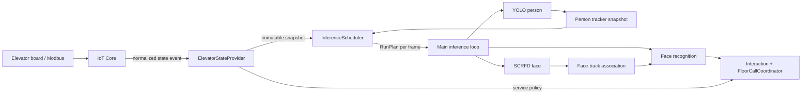

# Design: Adaptive inference theo trạng thái cabin

Trạng thái: **Draft**
Tài liệu yêu cầu: [requirements.md](requirements.md)

## 1. Kiến trúc



`ElevatorStateProvider` không điều khiển model. Nó chỉ xác thực và lưu snapshot. `InferenceScheduler`
không biết Socket.IO hoặc NPU; nó nhận dữ liệu và trả `RunPlan` cho frame hiện tại.

## 2. Data model

```cpp
enum class DoorState { Closed, Opening, Open, Closing, Unknown };
enum class ServiceMode { Normal, Maintenance, Emergency, Fire, Unknown };
enum class SchedulerState {
    Idle,
    Armed,
    DoorActive,
    OccupiedUnresolved,
    OccupiedResolved,
    EmptyGrace,
    Degraded,
    Inhibited,
};

struct ElevatorStateSnapshot {
    std::string device_code;
    int elevator = 0;
    std::string boot_id;
    std::uint64_t sequence = 0;
    std::int64_t source_timestamp_ms = 0;
    double received_monotonic_ms = 0.0;
    DoorState door = DoorState::Unknown;
    ServiceMode service_mode = ServiceMode::Unknown;
    int current_floor = 0;
    int direction = 0; // -1 down, 0 stopped/unknown, +1 up
    bool moving = false;
    bool call_pending = false;
    bool valid = false;
};

struct TrackSummary {
    int active = 0;
    int tracked_with_detection = 0;
    int lost = 0;
    int unresolved = 0;
    int resolved_known = 0;
    int resolved_unknown = 0;
    bool new_track_since_last_face_scan = false;
};

struct RunPlan {
    SchedulerState state;
    bool run_person = false;
    bool run_face = false;
    bool allow_recognition = false;
    bool allow_floor_call = false;
    const char* reason = nullptr;
};
```

`resolved_unknown` cần policy rõ: track đã thử đủ cửa sổ recognition có thể được coi là resolved cho
tần suất inference, nhưng vẫn hiển thị `unknown` và không bao giờ gọi tầng.

## 3. Module `ElevatorStateProvider`

API đề xuất:

```cpp
class ElevatorStateProvider {
public:
    StateApplyResult apply_event(std::string_view socketio_payload,
                                 double received_monotonic_ms);
    ElevatorStateSnapshot snapshot(double now_ms) const;
    void on_disconnected(double now_ms);
};
```

### Quy tắc apply

1. Parse toàn bộ payload với giới hạn kích thước.
2. Kiểm tra device code và elevator number.
3. Chuẩn hóa enum; giá trị không biết thành `Unknown`.
4. Nếu cùng `bootId`, chỉ nhận sequence lớn hơn sequence cuối.
5. Nếu `bootId` thay đổi, nhận snapshot mới và reset sequence baseline.
6. Lưu receive time monotonic cùng snapshot immutable.
7. Parser/callback không log raw payload có secret hoặc PII.

Nếu protocol không có `bootId`, reconnect phải gọi một event snapshot được đánh dấu rõ để reset
sequence; không suy đoán dựa vào sequence nhỏ.

## 4. Module `InferenceScheduler`

API đề xuất:

```cpp
class InferenceScheduler {
public:
    RunPlan plan(double now_ms,
                 const ElevatorStateSnapshot& elevator,
                 const TrackSummary& tracks);
    void reset(double now_ms);
};
```

Scheduler lưu:

- current state và thời điểm transition;
- deadline lần YOLO/SCRFD tiếp theo;
- thời điểm person cuối cùng;
- thời điểm door activity cuối;
- adaptive/shadow/baseline mode;
- counters phục vụ metrics.

### Deadline thay vì modulo frame

Hiện tại YOLO dùng `frame_id % person_every`. Adaptive scheduler phải dùng monotonic deadline:

```text
if now >= next_person_due:
    run_person = true
    next_person_due = now + person_interval(state)
```

Việc này giữ tần suất ổn định khi FPS camera thay đổi và cho phép `opening` kéo deadline về `now`.

## 5. Ưu tiên chọn state

Mỗi frame áp dụng theo thứ tự ưu tiên:

```text
if adaptive disabled:
    BASELINE plan
else if service_mode is maintenance/emergency/fire:
    INHIBITED
else if state missing/stale/unknown:
    DEGRADED
else if door is opening/open or within closing grace:
    DOOR_ACTIVE
else if tracks.unresolved > 0:
    OCCUPIED_UNRESOLVED
else if tracks.active > 0:
    OCCUPIED_RESOLVED
else if within session empty grace:
    EMPTY_GRACE
else if call_pending or within armed timeout:
    ARMED
else:
    IDLE
```

Door active được ưu tiên hơn occupied để giữ tốc độ phát hiện người mới trong lúc cửa mở. Service
mode inhibit được ưu tiên cao nhất.

## 6. Tính `TrackSummary`

Main tạo summary từ `tracker->active_tracks()`:

- `Tracked && !predicted_only`: evidence cho phép chạy face detector.
- `Lost` hoặc `predicted_only`: giữ cabin visit nhưng không tự kích hoạt SCRFD.
- `identity.latched && resident_id >= 0`: resolved known.
- track chưa latch hoặc unknown còn retry budget: unresolved.
- track unknown hết recognition window: resolved unknown.

Không dùng số face frame hiện tại để xác định cabin có người; person tracker vẫn là nguồn presence.

## 7. Tích hợp main loop

Luồng mục tiêu:

```cpp
tracker->predict(frame_context);
auto elevator = elevator_state.snapshot(now);
auto before = summarize_tracks(tracker->active_tracks());
RunPlan plan = scheduler.plan(now, elevator, before);

if (plan.run_person) {
    run_yolo();
    tracker->update(persons, frame_context);
}

auto after = summarize_tracks(tracker->active_tracks());
if (plan.run_face && after.tracked_with_detection > 0) {
    run_scrfd();
    associate_faces_to_tracks();
    if (plan.allow_recognition) recognize_only_eligible_tracks();
} else {
    faces.clear();
    face_track_ids.clear();
    face_labels.clear();
}
```

Scheduler có thể cần một lần re-plan nhẹ sau YOLO nếu frame đó vừa tạo track đầu tiên. Cách đơn giản:
`plan_after_person(now, after)` chỉ được nâng `run_face` từ false lên true, không chạy YOLO hai lần.

Preprocess 640x640 hiện dùng chung YOLO và SCRFD. Khi cả hai bị skip, có thể bỏ luôn
`detect_preprocess`; đây là phần tối ưu sau khi logic gating đã ổn định.

## 8. Socket.IO integration

Không mở kết nối WebSocket thứ hai nếu IoT Core cho phép state event trên cùng namespace. Refactor
transport theo hướng:

```cpp
class IoTCoreClient {
public:
    bool enqueue_floor(...);
    void set_command_status_callback(...);
    void set_elevator_state_callback(...);
};
```

Worker phân luồng packet:

- `43<ack_id>[...]` → command ACK hiện tại;
- `42["elevator/state", {...}]` → state callback;
- Engine.IO open/ping/pong giữ nguyên.

Callback phải được copy và gọi sau khi nhả mutex. State event không được đứng sau command queue hoặc
chờ ACK mới được xử lý.

Nếu IoT Core yêu cầu subscribe, gửi subscribe sau namespace `40` ready, rồi yêu cầu snapshot hiện
tại. Chi tiết packet là P0 trong task plan.

## 9. Tích hợp FloorCallCoordinator

Thêm policy input:

```cpp
floor_calls->set_inhibited(!run_plan.allow_floor_call, reason);
```

Quy tắc:

- `Normal + fresh state`: cho phép.
- `Maintenance/Emergency/Fire`: suppress.
- Missing/stale state: mặc định suppress command nhưng vẫn nhận diện và latch identity.
- Policy thay đổi sau khi command đã `SENT` không hủy hoặc gửi lệnh bù.
- Command `QUEUED` chưa gửi có thể expire/cancel theo policy nếu transport hỗ trợ cancellation rõ ràng.

## 10. Cấu hình

```text
adaptive_inference_enabled=true
adaptive_inference_shadow=true          # rollout đầu tiên
elevator_state_ttl_ms=3000
door_closing_grace_ms=1500
armed_timeout_ms=15000
unknown_resolve_ms=5000

idle_person_fps=2
armed_person_fps=10
door_person_fps=15
unresolved_person_fps=10
resolved_person_fps=3
empty_grace_person_fps=5
degraded_person_fps=5
inhibited_person_fps=2

active_face_fps=10
degraded_face_fps=10
```

Các giá trị phải qua một config struct được validate tập trung. FPS bằng 0 nghĩa là tắt stage trong
state đó. `adaptive_inference_enabled=false` phục hồi lịch baseline `person_every` và SCRFD mỗi frame.

## 11. Metrics và log

Log transition:

```text
[scheduler] state IDLE -> DOOR_ACTIVE reason=door_opening age_ms=12
[scheduler] state OCCUPIED_UNRESOLVED -> OCCUPIED_RESOLVED reason=all_tracks_resolved
[scheduler] state DOOR_ACTIVE -> DEGRADED reason=iot_state_stale age_ms=3120
```

Metrics theo chu kỳ báo cáo:

- frames captured;
- YOLO run/skip và milliseconds;
- SCRFD run/skip và milliseconds;
- recognition attempts/success/unknown và milliseconds;
- thời gian trong từng scheduler state;
- stale state count, reconnect count, out-of-order event count;
- person-first-seen → recognition-first-attempt latency;
- door-opening → first-person-scan latency.

Không log tên resident, raw RTSP URL hoặc raw state payload.

## 12. Test strategy

### Unit tests

- Table-driven scheduler transition cho mọi state.
- Monotonic deadline ở FPS camera thay đổi.
- Door opening làm person scan due ngay.
- State TTL, out-of-order sequence và boot ID reset.
- Multi-track known/unknown/new track.
- Face buffers được clear trên skipped frame.
- Floor-call inhibit theo service mode và stale state.

### Integration tests

- Fake Socket.IO server gửi open/ping/state/ACK xen kẽ.
- Reconnect trả snapshot mới.
- State event đến khi command đang in-flight.
- Video fixture cabin trống, một người, nhiều người, quay mặt và track split.
- So sánh baseline/shadow/enabled trên cùng video.

### Live tests

- Door opening/closing thật của thang máy số 2.
- IoT Core mất mạng, restart và state stale.
- Maintenance/emergency test bằng simulator nếu không thể kích hoạt board thật.
- Đo NPU executions, FPS, CPU, RAM và nhiệt độ trong ít nhất 30 phút idle và nhiều cabin visit.

## 13. Rollout

1. `shadow=true`: scheduler tính và log nhưng pipeline vẫn chạy baseline.
2. Bật gating SCRFD khi idle; giữ YOLO baseline.
3. Bật adaptive YOLO cadence với degraded fallback.
4. Bật per-track recognition policy đầy đủ.
5. Nối service-mode inhibit vào floor coordinator.
6. Theo dõi metrics và mở rộng dần; rollback bằng `adaptive_inference_enabled=false`.
