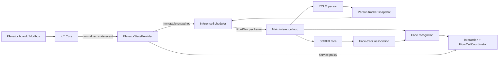

# Design: Adaptive inference theo trạng thái cabin

Trạng thái: **Draft**
Tài liệu yêu cầu: [requirements.md](requirements.md)

## Overview

Thiết kế này hiện thực [requirements.md](requirements.md): giảm số lần chạy NPU (YOLO person, SCRFD
face, face recognition) khi cabin không cần nhận diện, nhưng không bỏ lỡ hành khách và không làm sai
logic gọi tầng. Tần suất inference được điều chỉnh theo trạng thái cửa và service mode từ IoT Core,
độ mới của state, person track và identity của từng track.

Quyết định chính:

- Model vẫn load một lần lúc startup. "Tắt" một model nghĩa là bỏ qua lần chạy trong frame đó, không
  unload NPU context.
- `ElevatorStateProvider` nhận event trạng thái thang máy qua kết nối Socket.IO hiện có, xác thực và
  giữ snapshot immutable.
- `InferenceScheduler` là logic thuần (không gọi NPU, socket hay DB); mỗi frame nó trả một `RunPlan`.
- State thiếu, cũ hoặc `unknown` đưa scheduler về `DEGRADED` và quét dự phòng, không tắt inference.
- Maintenance/emergency/fire chặn gọi tầng tự động qua `FloorCallCoordinator`.
- Có shadow mode và một config để rollback về lịch baseline mà không build lại.

Phạm vi loại trừ giữ nguyên như mục "Ngoài phạm vi phiên bản đầu" của requirements.

## Architecture



`ElevatorStateProvider` không điều khiển model. Nó chỉ xác thực và lưu snapshot. `InferenceScheduler`
không biết Socket.IO hoặc NPU; nó nhận dữ liệu và trả `RunPlan` cho frame hiện tại.

### Ưu tiên chọn state

Mỗi frame áp dụng theo thứ tự ưu tiên:

```text
if adaptive disabled:
    BASELINE plan
else if service_mode is maintenance/emergency/fire:
    INHIBITED
else if state missing/stale/unknown:
    DEGRADED
else if door is opening/open or within closing grace:
    DOOR_ACTIVE
else if tracks.unresolved > 0:
    OCCUPIED_UNRESOLVED
else if tracks.active > 0:
    OCCUPIED_RESOLVED
else if within session empty grace:
    EMPTY_GRACE
else if call_pending or within armed timeout:
    ARMED
else:
    IDLE
```

Door active được ưu tiên hơn occupied để giữ tốc độ phát hiện người mới trong lúc cửa mở. Service
mode inhibit được ưu tiên cao nhất.

### Tích hợp main loop

Luồng mục tiêu:

```cpp
tracker->predict(frame_context);
auto elevator = elevator_state.snapshot(now);
auto before = summarize_tracks(tracker->active_tracks());
RunPlan plan = scheduler.plan(now, elevator, before);

if (plan.run_person) {
    run_yolo();
    tracker->update(persons, frame_context);
}

auto after = summarize_tracks(tracker->active_tracks());
if (plan.run_face && after.tracked_with_detection > 0) {
    run_scrfd();
    associate_faces_to_tracks();
    if (plan.allow_recognition) recognize_only_eligible_tracks();
} else {
    faces.clear();
    face_track_ids.clear();
    face_labels.clear();
}
```

Scheduler có thể cần một lần re-plan nhẹ sau YOLO nếu frame đó vừa tạo track đầu tiên. Cách đơn giản:
`plan_after_person(now, after)` chỉ được nâng `run_face` từ false lên true, không chạy YOLO hai lần.

Preprocess 640x640 hiện dùng chung YOLO và SCRFD. Khi cả hai bị skip, có thể bỏ luôn
`detect_preprocess`; đây là phần tối ưu sau khi logic gating đã ổn định.

## Components and Interfaces

### `ElevatorStateProvider`

API đề xuất:

```cpp
class ElevatorStateProvider {
public:
    StateApplyResult apply_event(std::string_view socketio_payload,
                                 double received_monotonic_ms);
    ElevatorStateSnapshot snapshot(double now_ms) const;
    void on_disconnected(double now_ms);
};
```

#### Quy tắc apply

1. Parse toàn bộ payload với giới hạn kích thước.
2. Kiểm tra device code và elevator number.
3. Chuẩn hóa enum; giá trị không biết thành `Unknown`.
4. Nếu cùng `bootId`, chỉ nhận sequence lớn hơn sequence cuối.
5. Nếu `bootId` thay đổi, nhận snapshot mới và reset sequence baseline.
6. Lưu receive time monotonic cùng snapshot immutable.
7. Parser/callback không log raw payload có secret hoặc PII.

Nếu protocol không có `bootId`, reconnect phải gọi một event snapshot được đánh dấu rõ để reset
sequence; không suy đoán dựa vào sequence nhỏ.

### `InferenceScheduler`

API đề xuất:

```cpp
class InferenceScheduler {
public:
    RunPlan plan(double now_ms,
                 const ElevatorStateSnapshot& elevator,
                 const TrackSummary& tracks);
    void reset(double now_ms);
};
```

Scheduler lưu:

- current state và thời điểm transition;
- deadline lần YOLO/SCRFD tiếp theo;
- thời điểm person cuối cùng;
- thời điểm door activity cuối;
- adaptive/shadow/baseline mode;
- counters phục vụ metrics.

#### Deadline thay vì modulo frame

Hiện tại YOLO dùng `frame_id % person_every`. Adaptive scheduler phải dùng monotonic deadline:

```text
if now >= next_person_due:
    run_person = true
    next_person_due = now + person_interval(state)
```

Việc này giữ tần suất ổn định khi FPS camera thay đổi và cho phép `opening` kéo deadline về `now`.

### Tính `TrackSummary`

Main tạo summary từ `tracker->active_tracks()`:

- `Tracked && !predicted_only`: evidence cho phép chạy face detector.
- `Lost` hoặc `predicted_only`: giữ cabin visit nhưng không tự kích hoạt SCRFD.
- `identity.latched && resident_id >= 0`: resolved known.
- track chưa latch hoặc unknown còn retry budget: unresolved.
- track unknown hết recognition window: resolved unknown.

Không dùng số face frame hiện tại để xác định cabin có người; person tracker vẫn là nguồn presence.

### `IoTCoreClient` (Socket.IO)

Không mở kết nối WebSocket thứ hai nếu IoT Core cho phép state event trên cùng namespace. Refactor
transport theo hướng:

```cpp
class IoTCoreClient {
public:
    bool enqueue_floor(...);
    void set_command_status_callback(...);
    void set_elevator_state_callback(...);
};
```

Worker phân luồng packet:

- `43<ack_id>[...]` → command ACK hiện tại;
- `42["elevator/state", {...}]` → state callback;
- Engine.IO open/ping/pong giữ nguyên.

Callback phải được copy và gọi sau khi nhả mutex. State event không được đứng sau command queue hoặc
chờ ACK mới được xử lý.

Nếu IoT Core yêu cầu subscribe, gửi subscribe sau namespace `40` ready, rồi yêu cầu snapshot hiện
tại. Chi tiết packet là task 0 trong task plan.

### `FloorCallCoordinator`

Thêm policy input:

```cpp
floor_calls->set_inhibited(!run_plan.allow_floor_call, reason);
```

Quy tắc:

- `Normal + fresh state`: cho phép.
- `Maintenance/Emergency/Fire`: suppress.
- Missing/stale state: mặc định suppress command nhưng vẫn nhận diện và latch identity.
- Policy thay đổi sau khi command đã `SENT` không hủy hoặc gửi lệnh bù.
- Command `QUEUED` chưa gửi có thể expire/cancel theo policy nếu transport hỗ trợ cancellation rõ ràng.

### Metrics và log

Log transition:

```text
[scheduler] state IDLE -> DOOR_ACTIVE reason=door_opening age_ms=12
[scheduler] state OCCUPIED_UNRESOLVED -> OCCUPIED_RESOLVED reason=all_tracks_resolved
[scheduler] state DOOR_ACTIVE -> DEGRADED reason=iot_state_stale age_ms=3120
```

Metrics theo chu kỳ báo cáo:

- frames captured;
- YOLO run/skip và milliseconds;
- SCRFD run/skip và milliseconds;
- recognition attempts/success/unknown và milliseconds;
- thời gian trong từng scheduler state;
- stale state count, reconnect count, out-of-order event count;
- person-first-seen → recognition-first-attempt latency;
- door-opening → first-person-scan latency.

Không log tên resident, raw RTSP URL hoặc raw state payload.

## Data Models

```cpp
enum class DoorState { Closed, Opening, Open, Closing, Unknown };
enum class ServiceMode { Normal, Maintenance, Emergency, Fire, Unknown };
enum class SchedulerState {
    Idle,
    Armed,
    DoorActive,
    OccupiedUnresolved,
    OccupiedResolved,
    EmptyGrace,
    Degraded,
    Inhibited,
};

struct ElevatorStateSnapshot {
    std::string device_code;
    int elevator = 0;
    std::string boot_id;
    std::uint64_t sequence = 0;
    std::int64_t source_timestamp_ms = 0;
    double received_monotonic_ms = 0.0;
    DoorState door = DoorState::Unknown;
    ServiceMode service_mode = ServiceMode::Unknown;
    int current_floor = 0;
    int direction = 0; // -1 down, 0 stopped/unknown, +1 up
    bool moving = false;
    bool call_pending = false;
    bool valid = false;
};

struct TrackSummary {
    int active = 0;
    int tracked_with_detection = 0;
    int lost = 0;
    int unresolved = 0;
    int resolved_known = 0;
    int resolved_unknown = 0;
    bool new_track_since_last_face_scan = false;
};

struct RunPlan {
    SchedulerState state;
    bool run_person = false;
    bool run_face = false;
    bool allow_recognition = false;
    bool allow_floor_call = false;
    const char* reason = nullptr;
};
```

`resolved_unknown` cần policy rõ: track đã thử đủ cửa sổ recognition có thể được coi là resolved cho
tần suất inference, nhưng vẫn hiển thị `unknown` và không bao giờ gọi tầng.

### Cấu hình

```text
adaptive_inference_enabled=true
adaptive_inference_shadow=true          # rollout đầu tiên
elevator_state_ttl_ms=3000
door_closing_grace_ms=1500
armed_timeout_ms=15000
unknown_resolve_ms=5000

idle_person_fps=2
armed_person_fps=10
door_person_fps=15
unresolved_person_fps=10
resolved_person_fps=3
empty_grace_person_fps=5
degraded_person_fps=5
inhibited_person_fps=2

active_face_fps=10
degraded_face_fps=10
```

Các giá trị phải qua một config struct được validate tập trung. FPS bằng 0 nghĩa là tắt stage trong
state đó. `adaptive_inference_enabled=false` phục hồi lịch baseline `person_every` và SCRFD mỗi frame.

## Correctness Properties

*Property là đặc tính phải đúng trên mọi lần chạy hợp lệ của hệ thống, tức một phát biểu hình thức
về việc hệ thống phải làm gì. Property là cầu nối giữa đặc tả đọc được và kiểm chứng tự động.*

Phần lớn property dưới đây áp dụng cho `InferenceScheduler` và `ElevatorStateProvider`. Đây là logic
thuần nên test được trên host, không cần NPU hay camera. Property về main loop (7, 8) cần fake tracker
và fake stage thay cho YOLO/SCRFD thật.

Trong dòng **Validates**, `X.Y` là requirement `RX` ý `Y` ở mục "Requirements" của requirements
(ví dụ `5.3` là R5 ý 3).

### Property 1: Thứ tự ưu tiên state

*Với mọi* tổ hợp cờ adaptive, `ElevatorStateSnapshot`, `TrackSummary` và timer nội bộ (closing grace,
empty grace, armed timeout), `plan()` phải trả state của nhánh đầu tiên khớp trong thứ tự ưu tiên ở
mục Architecture. `service_mode` là maintenance/emergency/fire luôn cho `INHIBITED`; state thiếu, cũ
hoặc `unknown` không bao giờ cho `IDLE`.

**Validates: Requirements 5.3, 6.2, 7.1, 8.2**

### Property 2: Deadline person theo monotonic time

*Với mọi* chuỗi `now_ms` tăng dần với khoảng cách frame bất kỳ, trong một state không đổi có
`person_fps = f > 0`, hai lần `run_person=true` liên tiếp phải cách nhau ít nhất `1000/f` ms và không
quá `1000/f` ms cộng khoảng cách frame lớn nhất. Với `f = 0`, `run_person` luôn là false.

**Validates: Requirements 2.1**

### Property 3: Chuyển sang active chạy YOLO ngay

*Với mọi* lịch sử scheduler và mọi giá trị `next_person_due`, lần `plan()` đầu tiên chuyển state từ
`IDLE` hoặc `DEGRADED` sang `ARMED`, `DOOR_ACTIVE` hoặc `OCCUPIED_UNRESOLVED` phải trả
`run_person=true`. Sau khi một snapshot `door=Opening` hợp lệ được apply, lần `plan()` kế tiếp phải
trả `DOOR_ACTIVE` (trừ khi service mode cho `INHIBITED`), không chờ debounce.

**Validates: Requirements 2.4, 6.1, 6.4**

### Property 4: Độ mới state dùng monotonic receive time

*Với mọi* snapshot và `now_ms`, snapshot bị coi là missing/stale khi và chỉ khi `valid=false` hoặc
`now_ms - received_monotonic_ms` vượt quá `elevator_state_ttl_ms`. Kết quả không phụ thuộc
`source_timestamp_ms`. Vì vậy, nếu không có event mới trong `elevator_state_ttl_ms`, scheduler không
thể giữ mãi state suy ra từ door event cuối.

**Validates: Requirements 5.3, 5.4, 7.2**

### Property 5: Lọc thiết bị, sequence và `bootId`

*Với mọi* chuỗi event (thứ tự bất kỳ, lẫn `deviceCode`/elevator khác, lẫn `bootId`), `apply_event` chấp
nhận một event khi và chỉ khi event parse hợp lệ, đúng `deviceCode`, đúng elevator số 2, và hoặc có
`bootId` khác `bootId` hiện tại, hoặc cùng `bootId` với sequence lớn hơn sequence cuối. Snapshot sau
chuỗi event phải bằng event được chấp nhận cuối cùng; event bị từ chối không làm đổi snapshot.

**Validates: Requirements 5.1, 5.2, 7.3**

### Property 6: Parser không làm hỏng worker

*Với mọi* chuỗi byte làm payload (JSON sai, thiếu trường, vượt giới hạn kích thước, enum lạ),
`apply_event` phải trả về mà không crash và không để exception thoát ra worker. Payload bị từ chối
không đổi snapshot; payload được chấp nhận chỉ chứa giá trị enum hợp lệ, giá trị lạ thành `Unknown`.

**Validates: Requirements 5.5, 9.1**

### Property 7: Person gating không làm sai tracker

*Với mọi* chuỗi `RunPlan`, `tracker->predict` chạy mỗi frame, còn `tracker->update` chỉ chạy ở frame
có `run_person=true`. Frame bỏ qua YOLO không bao giờ gọi `update` với detection rỗng.

**Validates: Requirements 2.2, 2.3**

### Property 8: Face gating cần person evidence

*Với mọi* frame, SCRFD chỉ chạy khi `run_face=true` và `after.tracked_with_detection > 0`. Frame không
chạy SCRFD phải kết thúc với `faces`, `face_track_ids` và `face_labels` rỗng. `plan_after_person` chỉ
được đổi `run_face` từ false sang true và không làm YOLO chạy lần thứ hai trong frame.

**Validates: Requirements 3.1, 3.2, 3.3, 3.4**

### Property 9: Recognition theo từng track

*Với mọi* tập track, recognition chỉ được thử cho track có `needs_recognition=true`. Track known đã
latch không bao giờ được thử lại trong vòng đời track, và một track đã resolved known không làm bỏ
lượt thử của track unresolved khác. Track mới xuất hiện khi đang `OCCUPIED_RESOLVED` phải đưa state
về `OCCUPIED_UNRESOLVED`.

**Validates: Requirements 4.1, 4.2, 4.4, 4.5**

### Property 10: Chính sách gọi tầng

*Với mọi* `RunPlan` khi adaptive bật, `allow_floor_call=true` khi và chỉ khi `service_mode=Normal` và
state còn mới. State thiếu/cũ chỉ chặn gọi tầng, không chặn recognition hay latch identity. Thay đổi
policy không hủy và không gửi bù command đã `SENT`.

**Validates: Requirements 8.2, 8.4**

### Property 11: Baseline và shadow không đổi inference

*Với mọi* chuỗi input, khi `adaptive_inference_enabled=false` hoặc `adaptive_inference_shadow=true`,
các stage chạy trong từng frame phải trùng lịch baseline (YOLO theo `person_every`, SCRFD mỗi frame).
Ở shadow mode, scheduler vẫn tính và log decision.

**Validates: Requirements 7.4, 10.4, 10.5**

### Property 12: Log không chứa PII

*Với mọi* transition log và metrics report, nội dung không chứa tên resident, `greeting_name`, căn hộ,
URL camera hay raw state payload. `reason` là chuỗi cố định; định danh chỉ ở dạng số.

**Validates: Requirements 10.1**

## Error Handling

Nguyên tắc: lỗi ở state input không được tắt inference vô hạn hay làm crash inference loop. Khi không
tin được state, scheduler quét dự phòng (`DEGRADED`) và chặn gọi tầng. Lỗi trả theo convention của
repo (`bool`/`StateApplyResult` + log + counter), không throw qua ranh giới thread.

| Tình huống | Xử lý |
|---|---|
| Payload parse lỗi, vượt giới hạn kích thước hoặc thiếu trường bắt buộc | `apply_event` reject, snapshot giữ nguyên, log reason không kèm raw payload |
| `deviceCode` hoặc elevator không khớp | Reject, snapshot giữ nguyên |
| Enum lạ | Chuẩn hóa thành `Unknown`; door/service mode `Unknown` dẫn tới `DEGRADED` |
| Sequence cũ hoặc trùng trong cùng `bootId` | Bỏ event, tăng out-of-order event count |
| `bootId` thay đổi | Nhận snapshot mới, reset sequence baseline |
| Protocol không có `bootId` | Chỉ reset sequence bằng snapshot event được đánh dấu khi reconnect; không suy đoán từ sequence nhỏ |
| Mất kết nối Socket.IO | `on_disconnected` đánh dấu mất kết nối; scheduler vào `DEGRADED` theo điều kiện S6 của requirements; tăng reconnect count |
| IoT Core offline lúc startup | Snapshot `valid=false`, scheduler ở `DEGRADED` và chạy person scan dự phòng |
| State quá `elevator_state_ttl_ms` | `DEGRADED`, tăng stale state count, log `reason=iot_state_stale` |
| Service mode `Unknown` | `DEGRADED`, suppress gọi tầng, vẫn nhận diện và latch identity |
| Policy đổi sau khi command đã `SENT` | Không hủy, không gửi lệnh bù |
| Command `QUEUED` khi bị inhibit | Expire/cancel chỉ khi transport hỗ trợ cancellation rõ ràng |
| State callback | Copy callback và gọi sau khi nhả mutex; state event không chờ command queue hay ACK |
| Giá trị config sai | Validate tập trung trong config struct. **Chưa chốt:** từ chối khởi động hay fallback về baseline |

## Testing Strategy

`InferenceScheduler`, `ElevatorStateProvider` và `summarize_tracks` là logic thuần, test được trên
host bằng harness hiện có. Mỗi test là một `main()` riêng và phải được đăng ký trong
`tests/run_tests.sh`. Số trong ngoặc là property được test kiểm.

### Unit tests

- Table-driven scheduler transition cho mọi state (Property 1, 9).
- Monotonic deadline ở FPS camera thay đổi (Property 2).
- Door opening làm person scan due ngay (Property 3).
- State TTL, out-of-order sequence và boot ID reset (Property 4, 5).
- Payload sai, quá lớn hoặc enum lạ không crash và không đổi snapshot (Property 6).
- Frame skip YOLO không gọi tracker `update` (Property 7).
- Multi-track known/unknown/new track (Property 9).
- Face buffers được clear trên skipped frame (Property 8).
- Floor-call inhibit theo service mode và stale state (Property 10).
- Log transition/metrics không chứa chuỗi PII đã cài vào input (Property 12).

### Integration tests

- Fake Socket.IO server gửi open/ping/state/ACK xen kẽ.
- Reconnect trả snapshot mới.
- State event đến khi command đang in-flight.
- Video fixture cabin trống, một người, nhiều người, quay mặt và track split.
- So sánh baseline/shadow/enabled trên cùng video (Property 11).

### Live tests

- Door opening/closing thật của thang máy số 2.
- IoT Core mất mạng, restart và state stale.
- Maintenance/emergency test bằng simulator nếu không thể kích hoạt board thật.
- Đo NPU executions, FPS, CPU, RAM và nhiệt độ trong ít nhất 30 phút idle và nhiều cabin visit.

## Rollout

1. `shadow=true`: scheduler tính và log nhưng pipeline vẫn chạy baseline.
2. Bật gating SCRFD khi idle; giữ YOLO baseline.
3. Bật adaptive YOLO cadence với degraded fallback.
4. Bật per-track recognition policy đầy đủ.
5. Nối service-mode inhibit vào floor coordinator.
6. Theo dõi metrics và mở rộng dần; rollback bằng `adaptive_inference_enabled=false`.
