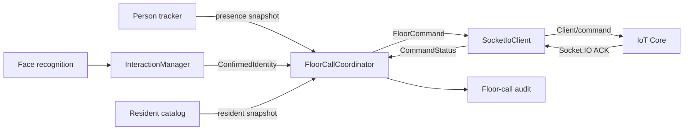
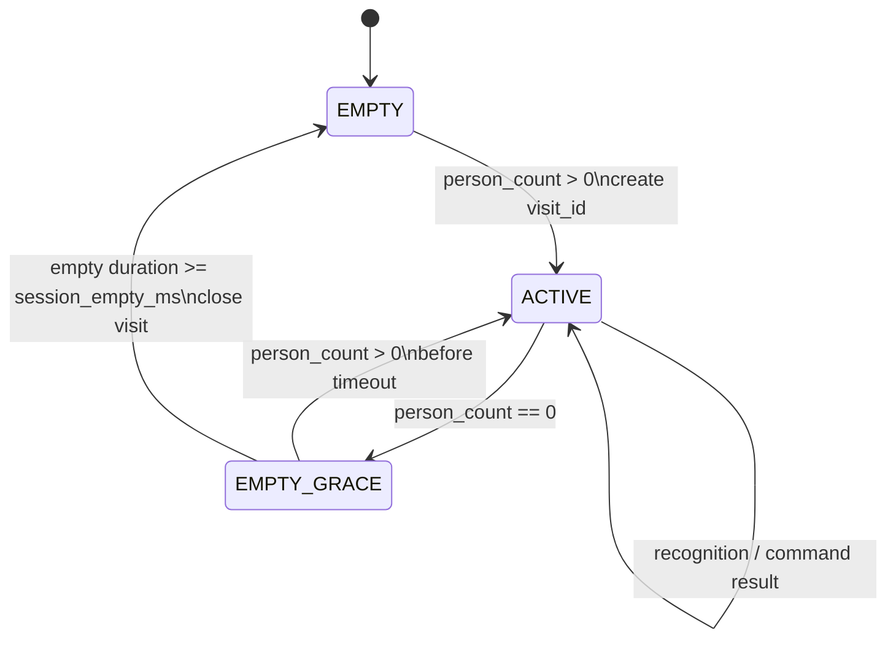
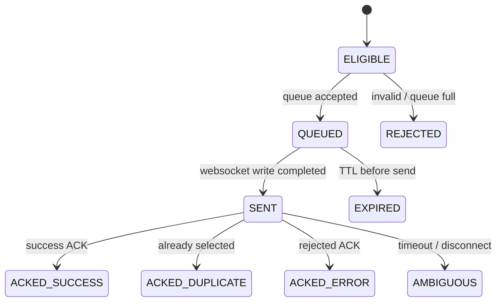

# Design: Điều phối gọi tầng tự động

Trạng thái: **Draft**
Tài liệu yêu cầu: [requirements.md](requirements.md)

## Overview

Thiết kế này hiện thực [requirements.md](requirements.md): AI Core gọi đúng tầng của cư dân đã được
nhận diện, chỉ gọi số lần cần thiết trong một phiên cabin, không chặn luồng camera/inference và theo
dõi được từng lệnh từ lúc xếp hàng tới khi IoT Core trả ACK nghiệp vụ.

Các quyết định chính:

- Tách ba trách nhiệm: `InteractionManager` xác nhận danh tính, `FloorCallCoordinator` quyết định có
  gọi tầng trong phiên cabin hiện tại hay không, `SocketIoClient` truyền lệnh và trả kết quả truyền.
- Chống gọi trùng theo `resident_id` và theo tầng trong toàn bộ phiên cabin, không dựa vào cooldown
  3 giây của `InteractionManager`.
- Biên phiên cabin dựa trên presence từ person tracker, không dựa trên số khuôn mặt trong frame.
- Mỗi tầng là một write `2^floor` riêng; board giữ các tầng đã chọn qua nhiều write.
- Mỗi command có `requestId` duy nhất. Chỉ `ACKED_SUCCESS` hoặc `ACKED_DUPLICATE` được tính là gọi
  tầng thành công.
- Có shadow mode để chạy logic mà không gửi lệnh, và rollback bằng config không cần build lại.

Phạm vi loại trừ giữ nguyên như mục "Ngoài phạm vi phiên bản đầu" của requirements.

## Architecture



`InteractionManager` không quyết định gọi tầng. Nó chỉ phát `ConfirmedIdentity`. Coordinator giữ
ngữ cảnh phiên cabin và áp dụng policy. `SocketIoClient` chỉ chịu trách nhiệm transport, ACK và
reconnect.

### State machine phiên cabin



State của phiên được mô tả ở `CabinVisit` trong mục Data Models.

#### Nguồn presence

Presence phải lấy từ person tracker, không lấy từ số khuôn mặt trong frame. Một người quay mặt đi vẫn
ở cabin và không được làm kết thúc phiên. Track `Lost` còn trong `track_lost_ms` vẫn tính là hiện diện.

Nếu tracker chưa cung cấp person snapshot đáng tin cậy, bản đầu có thể dùng tập active track hiện có,
nhưng phải đặt `session_empty_ms` lớn hơn `track_lost_ms`. Điều kiện cấu hình:

```text
session_empty_ms >= track_lost_ms
```

Đề xuất thực tế: `track_lost_ms` theo tracker spec và `session_empty_ms=5000`.

### State machine command



`SocketIoClient` phát callback cho mọi transition mà nó sở hữu. Coordinator cập nhật snapshot và đẩy
audit record sang một queue riêng nếu DB write có thể chặn.

### Semantics register và nhiều tầng

Board đã được xác nhận giữ các tầng đã chọn qua nhiều write. Mỗi write `2^floor` có nghĩa là set thêm
tầng tương ứng, không thay thế toàn bộ bitmask hiện có.

Do đó AI Core gửi từng tầng thành một command riêng:

```text
floor 5 -> write 32 -> ACK
floor 6 -> write 64 -> ACK
```

Sau hai write, board giữ cả tầng 5 và tầng 6. AI Core không cần đọc register, tự OR bit hoặc gửi lại
giá trị tổng `96`. Cơ chế FIFO và một command in-flight vẫn được giữ để ACK luôn tương quan rõ ràng.

## Components and Interfaces

### `FloorCallCoordinator`

Coordinator chạy thuật toán thuần trạng thái, không I/O:

```text
on_confirmed(identity):
  ensure an ACTIVE visit exists

  if resident_id already exists in resident_decisions:
      emit SUPPRESSED_SAME_RESIDENT
      return

  snapshot resident decision immediately

  if resident missing/inactive:
      finalize REJECTED_RESIDENT
      return
  if home_floor <= 0:
      finalize SUPPRESSED_NO_FLOOR
      return
  if home_floor outside cabin range or cannot be encoded:
      finalize REJECTED_INVALID_FLOOR
      return
  if automatic floor calls are inhibited:
      finalize SUPPRESSED_POLICY
      return
  if floor exists in floor_request_ids:
      finalize SUPPRESSED_SAME_FLOOR, reference existing request_id
      return

  create unique request_id and immutable FloorCommand snapshot
  reserve resident_id and floor inside visit
  enqueue to SocketIoClient

  if enqueue succeeds:
      transition ELIGIBLE -> QUEUED
  else:
      transition ELIGIBLE -> REJECTED_QUEUE_FULL
      release floor reservation only if transport proves command was never accepted
```

Resident decision được ghi trước khi trả về để hai recognition gần nhau không thể cùng qua gate.

#### Thứ tự deterministic

Main gom các outcome trong cùng một frame rồi sort theo:

1. `confirmed_at_ms` tăng dần;
2. `resident_id` tăng dần;
3. `subject_key` tăng dần.

Sau đó mới gọi coordinator. Điều này làm test ổn định dù container/track có thứ tự khác nhau.

#### Dedupe

Hai khóa phục vụ hai mục đích khác nhau:

- `resident_decisions[resident_id]`: chống một cư dân gọi lại do track split hoặc recognition lặp.
- `floor_request_ids[floor]`: gộp nhiều cư dân cùng tầng.

Không xóa hai khóa này khi khuôn mặt biến mất, track đổi ID, cooldown kết thúc hoặc command ACK lỗi.
Chúng chỉ được xóa khi phiên cabin kết thúc. Trường hợp enqueue chắc chắn thất bại trước send có thể
giải phóng khóa tầng để một yêu cầu khác thử lại, nhưng vẫn giữ quyết định của resident đầu tiên để
không tạo vòng lặp mỗi frame.

### `SocketIoClient`

API đích:

```cpp
using StatusCallback = std::function<void(const TransportResult&)>;

bool enqueue(FloorTransportCommand command);
void set_status_callback(StatusCallback callback);
```

Queue giữ request ID và metadata. Callback được gọi sau khi đã nhả mutex nội bộ.

#### Quy tắc thành công

- `ACKED_SUCCESS`: IoT Core xác nhận thao tác write/select-floor thành công.
- `ACKED_DUPLICATE`: IoT Core xác nhận tầng đã được chọn; kết quả hành vi tương đương thành công.
- `SENT` không phải thành công.
- ACK có đúng `ack_id` nhưng không parse được payload phải là `ACKED_ERROR` với code
  `MALFORMED_ACK`, không được tăng metric success.

#### Timeout và reconnect

- `QUEUED` quá `command_ttl_ms`: `EXPIRED`.
- Mất kết nối khi chưa send: giữ queue nếu còn TTL.
- Mất kết nối hoặc timeout sau send: `AMBIGUOUS`.
- Không retry `AMBIGUOUS` với `requestId` cố định hoặc khi IoT Core chưa cam kết idempotency.
- Sau khi có unique request ID và server dedupe, retry giữ nguyên `request_id`, tạo Socket.IO ack id
  mới và giới hạn số lần.

### Protocol Socket.IO

Payload mục tiêu:

```text
42<ack_id>["Client/command",{
  "action":"write",
  "deviceCode":"2026010900100098",
  "address":"8193-2",
  "value":32,
  "requestId":"ai-core:<cabin_id>:<visit_id>:<sequence>"
}]
```

Ví dụ floor 5 có `value=32`. `ack_id` thuộc phạm vi connection; `requestId` thuộc phạm vi nghiệp vụ.

ACK cần được chốt với IoT Core. Schema đề xuất:

```json
{
  "requestId": "ai-core:2:104:1",
  "success": true,
  "code": "OK",
  "message": "floor selected"
}
```

Các code tối thiểu:

| Code | Phân loại | Retry |
|---|---|---|
| `OK` | `ACKED_SUCCESS` | Không |
| `ALREADY_SELECTED` | `ACKED_DUPLICATE` | Không |
| `INVALID_ADDRESS` | `ACKED_ERROR` | Không |
| `INVALID_VALUE` | `ACKED_ERROR` | Không |
| `DEVICE_OFFLINE` | `ACKED_ERROR` | Có, khi idempotency đã hỗ trợ |
| `FORBIDDEN_MODE` | `ACKED_ERROR` | Không |

### `InteractionManager`

Giữ nhiệm vụ confirm danh tính. Cần sửa lỗi identity đã `CONFIRMED` bị reset về `DETECTING` khi một
frame không match nếu tracker đã latch danh tính. Cách ưu tiên:

- main truyền identity latched của person track vào interaction;
- sau `CONFIRMED`, interaction không phát confirmed lần nữa cho session đó;
- catalog invalidation/admin reset mới được phép xóa identity latch theo rule tracker spec.

### `main.cpp`

Thay đoạn gọi trực tiếp:

```cpp
iot_socket->send_floor(hf);
```

bằng:

```cpp
floor_coordinator.on_confirmed(confirmed_identity);
```

Mỗi frame, main cũng gọi:

```cpp
floor_coordinator.on_presence(presence_snapshot);
```

Không gán `match_events.floor_selected` chỉ vì queue nhận lệnh. Có thể giữ `match_events` cho nhận
diện và tạo bảng/event stream riêng cho floor-call lifecycle.

### Dữ liệu từ IoT Core

Phiên bản đầu không cần đọc raw board register để gọi một tầng. AI Core cần:

1. ACK nghiệp vụ cho command do chính AI gửi.
2. Sau này, một event chuẩn hóa về `service_mode`, `door_state`, `current_floor` nếu nghiệp vụ yêu cầu
   chặn gọi trong emergency/maintenance hoặc dùng door cycle làm biên phiên.

AI Core không nên phụ thuộc trực tiếp vào địa chỉ register đầu vào của từng board. IoT Core nên chuyển
chúng thành event có schema ổn định.

## Data Models

### Kiểu dữ liệu đề xuất

```cpp
using VisitId = std::uint64_t;

struct PresenceSnapshot {
    double now_ms;
    std::vector<int> active_person_track_ids; // gồm tracked và lost còn trong grace
};

struct ConfirmedIdentity {
    int subject_key;
    std::int64_t resident_id;
    int home_floor;
    float similarity;
    double confirmed_at_ms;
    std::uint64_t catalog_generation;
};

enum class FloorCommandState {
    ELIGIBLE,
    QUEUED,
    SENT,
    ACKED_SUCCESS,
    ACKED_DUPLICATE,
    ACKED_ERROR,
    EXPIRED,
    AMBIGUOUS,
    SUPPRESSED,
    REJECTED,
};

struct FloorCommand {
    VisitId visit_id;
    std::uint64_t sequence;
    std::string request_id;
    std::int64_t resident_id;
    int subject_key;
    int floor;
    std::int64_t value;
    float similarity;
    double created_at_ms;
    FloorCommandState state;
    std::string reason;
};

struct TransportResult {
    std::string request_id;
    int socket_ack_id;
    enum Kind { SENT, SUCCESS, DUPLICATE, ERROR, EXPIRED, AMBIGUOUS } kind;
    std::string code;
    std::string message;
    bool retryable;
};
```

Transport queue phải chứa `FloorCommand`, không chỉ `floor`, để callback luôn tương quan đúng lệnh.

### `CabinVisit`

```cpp
struct CabinVisit {
    VisitId id = 0;
    double started_at_ms = 0;
    std::optional<double> empty_since_ms;
    std::unordered_map<std::int64_t, ResidentDecision> resident_decisions;
    std::unordered_map<int, std::string> floor_request_ids;
    std::unordered_map<std::string, FloorCommand> commands;
    std::uint64_t next_sequence = 1;
};
```

### Bảng audit `floor_call_events`

Đề xuất bảng riêng thay vì overload `match_events`:

```sql
CREATE TABLE floor_call_events (
    id              bigserial PRIMARY KEY,
    cabin_id        integer NOT NULL,
    visit_id        bigint NOT NULL,
    request_id      text NOT NULL,
    resident_id     bigint NULL,
    floor           integer NULL,
    register_value  bigint NULL,
    state           text NOT NULL,
    reason          text NULL,
    ack_code        text NULL,
    created_at      timestamptz NOT NULL DEFAULT now(),
    UNIQUE (request_id, state)
);
```

Nếu chưa muốn migration DB, giai đoạn đầu ghi structured log. Không dùng
`match_events.floor_selected` làm bằng chứng board đã nhận lệnh.

### Cấu hình

| Cấu hình | Mặc định | Ý nghĩa |
|---|---:|---|
| `floor_call_enabled` | `false` khi rollout | Bật gửi command thật |
| `floor_call_shadow` | `true` | Chạy logic và log nhưng không gửi |
| `floor_session_empty_ms` | `5000` | Cabin trống bao lâu thì đóng phiên |
| `floor_command_ttl_ms` | `5000` | Tuổi tối đa trước send |
| `floor_ack_timeout_ms` | `3000` | Chờ ACK sau send |
| `floor_dedupe_by_floor` | `true` | Gộp cư dân cùng tầng |
| `floor_max_commands_per_visit` | `16` | Giới hạn lỗi dữ liệu/recognition |
| `floor_retry_count` | `0` | Chỉ tăng sau khi server có idempotency |

`floor_call_enabled` và `floor_call_shadow` không cùng bật. Khi shadow, coordinator vẫn sinh đầy đủ
decision/audit nhưng transport không gửi.

## Correctness Properties

*Property là đặc tính phải đúng trên mọi lần chạy hợp lệ của hệ thống, tức một phát biểu hình thức
về việc hệ thống phải làm gì. Property là cầu nối giữa đặc tả đọc được và kiểm chứng tự động.*

Phần lớn property áp dụng cho `FloorCallCoordinator`, là logic thuần không phụ thuộc socket hay DB.
Các property về ACK và transport áp dụng cho các hàm encode/parse và queue của `SocketIoClient`.

Trong dòng **Validates**, `X.Y` là requirement `RX` ý `Y` ở mục "Yêu cầu chức năng" của requirements
(ví dụ `9.2` là R9 ý 2). Với R2 và R8, vốn là danh sách không đánh số, chỉ ghi `X`.

### Property 1: Biên phiên cabin

*Với mọi* chuỗi presence snapshot có `now_ms` tăng dần, phiên hiện tại chỉ kết thúc khi số người hiện
diện bằng 0 liên tục ít nhất `session_empty_ms`. Mọi khoảng trống ngắn hơn, kể cả khi track chuyển
`Lost` hoặc không thấy khuôn mặt, giữ nguyên `visit_id`. Người hiện diện đầu tiên sau khi phiên đóng
mở phiên mới với `visit_id` lớn hơn, và các khóa dedupe của phiên cũ không còn hiệu lực.

**Validates: Requirements 1.1, 1.2, 1.3, 1.5**

### Property 2: Mỗi resident một quyết định trong một phiên

*Với mọi* chuỗi confirmed identity trong cùng một phiên, bất kể `subject_key`, track split, ghost
track, recognition lặp hay cooldown của `InteractionManager` đã hết, mỗi `resident_id` có đúng một
quyết định cuối. Mọi lần confirmed sau đó cho cùng resident trả `SUPPRESSED_SAME_RESIDENT` và không
tạo command.

**Validates: Requirements 3.1, 3.2, 3.3, 6.2**

### Property 3: Tối đa một command cho mỗi tầng trong một phiên

*Với mọi* tập resident trong cùng một phiên, số command được tạo cho mỗi tầng không quá 1. Resident
đến sau có cùng tầng nhận `SUPPRESSED_SAME_FLOOR` kèm `request_id` của command đã có. Command ở
`AMBIGUOUS` vẫn giữ tầng. Ngoại lệ duy nhất: khi transport chứng minh command chưa bao giờ được nhận
(enqueue thất bại), khóa tầng được giải phóng nhưng quyết định của resident đầu tiên vẫn giữ.

**Validates: Requirements 4.1, 4.2, 4.3, 4.4, 5.4**

### Property 4: Gate điều kiện gọi tầng

*Với mọi* confirmed identity, coordinator tạo command khi và chỉ khi resident tồn tại/active,
`home_floor > 0`, `floors_min <= home_floor <= floors_max`, tầng mã hóa được, resident chưa có quyết
định trong phiên, tầng chưa được yêu cầu và gọi tầng tự động không bị inhibit. Unknown không bao giờ
tạo command. Mọi trường hợp còn lại trả `SUPPRESSED` hoặc `REJECTED` với reason tương ứng, và hệ
thống tiếp tục xử lý người khác.

**Validates: Requirements 2, 6.1, 6.2, 6.3**

### Property 5: Một tầng mỗi write, giá trị `2^floor`

*Với mọi* tầng hợp lệ, command mang đúng một tầng và `value == 2^floor` (tầng 5 cho `32`, tầng 6 cho
`64`). Coordinator không bao giờ OR nhiều tầng vào một command.

**Validates: Requirements 5.4, 5.5, 5.6**

### Property 6: Thứ tự xác định

*Với mọi* hoán vị của các outcome trong cùng một frame, chuỗi command và decision sinh ra là như
nhau, theo thứ tự `confirmed_at_ms`, rồi `resident_id`, rồi `subject_key` tăng dần.

**Validates: Requirements 5.1, 5.2**

### Property 7: Snapshot resident bất biến

*Với mọi* thay đổi catalog xảy ra sau khi command được tạo, `resident_id`, `floor`, `value` và
`similarity` của command đó không đổi. Resident bị xóa/deactivate chỉ làm command chưa gửi bị hủy có
reason; command đã gửi tiếp tục theo ACK hoặc `AMBIGUOUS` và không sinh lệnh bù. Phiên mới dùng
catalog mới nhất.

**Validates: Requirements 7.1, 7.2, 7.3, 7.4**

### Property 8: Vòng đời command hợp lệ

*Với mọi* chuỗi sự kiện transport (send, ACK, timeout, disconnect, hết TTL), command chỉ đi theo các
transition trong state machine command, và trạng thái terminal không đổi nữa. Metric success và
`floor_selected` chỉ được ghi ở `ACKED_SUCCESS` hoặc `ACKED_DUPLICATE`, không bao giờ ở `QUEUED` hay
`SENT`.

**Validates: Requirements 8, 10.4**

### Property 9: Tương quan và phân loại ACK

*Với mọi* packet ACK, kết quả chỉ được áp cho command khi `ack_id` khớp với kết nối hiện tại và
`requestId` khớp với command in-flight. ACK đúng `ack_id` nhưng payload không parse được hoặc
`success=false` cho `ACKED_ERROR`, không bao giờ là thành công. Mọi `request_id` sinh ra là duy nhất
theo `cabin_id`, `visit_id` và `sequence`.

**Validates: Requirements 10.1, 10.2, 10.3, 10.4**

### Property 10: TTL, ambiguous và giới hạn retry

*Với mọi* thời điểm mất kết nối: command chưa gửi và còn TTL được giữ trong queue; command `QUEUED`
quá `command_ttl_ms` thành `EXPIRED` và không bao giờ được gửi sau đó; command đã gửi mà không có ACK
thành `AMBIGUOUS` và không được gửi lại khi `floor_retry_count=0`. Khi retry được bật, số lần thử
không vượt quá `floor_retry_count`, chỉ áp cho lỗi retryable và giữ nguyên `request_id`.

**Validates: Requirements 9.1, 9.2, 9.3, 9.4**

### Property 11: Một command in-flight, gửi FIFO

*Với mọi* chuỗi command được enqueue, transport có tối đa một command đang chờ ACK, và các command
được gửi theo đúng thứ tự enqueue.

**Validates: Requirements 5.3, 5.5**

### Property 12: Không chặn pipeline realtime

*Với mọi* lời gọi `on_presence`/`on_confirmed`, coordinator không làm I/O mạng hay DB đồng bộ. Queue
đầy trả kết quả `REJECTED` có reason, không chặn caller và không sinh lại command mỗi frame. Callback
từ transport được gọi sau khi nhả lock, nên callback gọi ngược vào coordinator không deadlock. Lỗi
của một command không làm mất các command hợp lệ khác.

**Validates: Requirements 9.5, 12.1, 12.2, 12.3**

### Property 13: Audit đầy đủ, không PII

*Với mọi* decision và transition, có một audit record chứa `visit_id`, `request_id`, `resident_id`,
`floor`, `value`, `state`, `reason`, timestamp và ACK code nếu có. Audit, log và metrics không chứa tên
resident, `greeting_name`, căn hộ hay embedding; định danh chỉ ở dạng số.

**Validates: Requirements 11.1, 11.2, 11.3**

## Error Handling

Nguyên tắc: lỗi của một command không được dừng nhận diện, không chặn inference loop và không tạo
vòng lặp gọi lại mỗi frame. Lỗi trả theo convention của repo (`bool`/state + reason + log), không
throw qua ranh giới thread. Mọi trường hợp đều có decision với reason để audit.

| Tình huống | Xử lý |
|---|---|
| Unknown | Không gọi coordinator, không có command |
| Resident không tồn tại hoặc không active | `REJECTED_RESIDENT`; ghi resident decision cho phiên |
| `home_floor <= 0` | `SUPPRESSED_NO_FLOOR`; ghi một lần trong phiên |
| Tầng ngoài phạm vi cabin hoặc không encode được | `REJECTED_INVALID_FLOOR`; tiếp tục xử lý người khác |
| Gọi tầng tự động bị inhibit | `SUPPRESSED_POLICY` |
| Resident đã có quyết định trong phiên | `SUPPRESSED_SAME_RESIDENT` |
| Tầng đã có command trong phiên | `SUPPRESSED_SAME_FLOOR`, tham chiếu `request_id` đã có |
| Vượt `floor_max_commands_per_visit` | `REJECTED` với reason giới hạn command của phiên |
| Transport queue đầy | `REJECTED_QUEUE_FULL`; giữ resident decision; giải phóng khóa tầng vì command chắc chắn chưa gửi |
| `QUEUED` quá `command_ttl_ms` | `EXPIRED`; không gửi khi kết nối phục hồi |
| Mất kết nối trước send | Giữ command trong queue nếu còn TTL |
| Timeout ACK hoặc mất kết nối sau send | `AMBIGUOUS`; giữ khóa tầng; không retry khi IoT Core chưa có idempotency |
| ACK `success=false` | `ACKED_ERROR` với code của IoT Core; chỉ retry lỗi retryable, tối đa `floor_retry_count` |
| ACK đúng `ack_id` nhưng payload không parse được | `ACKED_ERROR` với code `MALFORMED_ACK`; không tăng metric success |
| Catalog đổi `home_floor` khi command đang queue | Command giữ snapshot cũ |
| Resident bị xóa/deactivate khi command chưa gửi | Hủy command có reason; command đã gửi đi tiếp theo ACK hoặc `AMBIGUOUS`, không gửi bù |
| Callback trạng thái từ transport | Gọi sau khi nhả mutex nội bộ; coordinator xử lý thread-safe |
| DB audit write có thể chặn | Đẩy audit record sang queue riêng; giai đoạn đầu có thể chỉ ghi structured log |
| `floor_session_empty_ms < track_lost_ms` | Parser config từ chối khởi động với lỗi `invalid --floor-session-empty-ms` |
| `floor_call_enabled` và `floor_call_shadow` cùng bật | **Chưa chốt:** từ chối khởi động hay ưu tiên shadow |

## Testing Strategy

`FloorCallCoordinator` là logic thuần, còn phần encode packet và parse ACK của `SocketIoClient` không
cần IoT Core thật, nên cả hai test được trên host bằng harness hiện có. Mỗi test là một `main()`
riêng, phải được đăng ký trong `tests/run_tests.sh` và chạy bằng `bash tests/run_tests.sh`. Số trong
ngoặc là property được test kiểm; mã `task 7.x`/`task 8.x` là task trong [tasks.md](tasks.md).

### Unit tests

Test hiện có:

- `tests/test_floor_call_coordinator.cpp`: một command `32` cho tầng 5, `request_id` duy nhất, dedupe
  resident khi đổi track, dedupe tầng, no-floor, tầng ngoài phạm vi, ghi nhận ACK success, biên phiên
  và quyền gọi lại ở phiên mới (Property 1, 2, 3, 4, 5).
- `tests/test_socketio_client.cpp`: `2^floor` và từ chối tầng không encode được, packet
  `Client/command` có `requestId`, parse ACK success/already-selected/error và từ chối ACK thiếu
  payload (Property 5, 9).

Test cần bổ sung:

- Hoán vị outcome cùng frame cho cùng chuỗi command (task 7.4; Property 6).
- Queue full, expiry và command limit có reason đúng (task 7.7; Property 3, 10, 12).
- Disconnect trước send giữ command còn TTL; disconnect sau send tạo `AMBIGUOUS` (task 7.9;
  Property 10).
- Một command in-flight và thứ tự FIFO (task 4.6; Property 11).
- Callback reentrant không deadlock (task 7.10; Property 12).
- Catalog change không âm thầm sửa command snapshot (task 7.11; Property 7).
- Recognition lặp sau cooldown 3 giây không gọi lại trong cùng phiên (task 7.12; Property 2).
- Transition không hợp lệ và trạng thái terminal không đổi (Property 8).
- Decision/log không chứa chuỗi PII đã cài vào input (Property 13).

### Integration và live tests

- Shadow test bằng video: một người quay đầu, che mặt, bị đổi track; nhiều người cùng tầng và khác
  tầng (task 8.1, 8.2).
- Một resident trên thang máy số 2: `8193-2`, tầng 5, value `32`; đối chiếu TX, ACK payload, audit
  state và nút tầng thực tế (task 8.3, 8.4).
- Nhiều tầng thật: gửi `32` rồi `64`, xác nhận board giữ cả tầng 5 và tầng 6 (task 8.9).
- Fault injection: tắt mạng trước send, sau send và khi chờ ACK; IoT Core restart trong phiên (task
  8.5, 8.6).
- Camera dropout ngắn không đóng cabin visit (task 8.7).
- FPS không giảm đáng kể khi command/ACK hoạt động (task 8.8).

## Rollout

1. **Shadow:** chạy coordinator, log `WOULD_CALL`, không gửi; kiểm tra duplicate và biên phiên bằng
   video thực tế.
2. **Một người:** bật command thật cho một cabin, xác nhận ACK success và audit.
3. **Nhiều người cùng tầng:** xác nhận chỉ một write.
4. **Nhiều người khác tầng:** gửi tuần tự từng tầng và xác nhận board giữ tất cả tầng đã chọn.
5. **Fault injection:** socket offline, ACK lỗi, timeout, disconnect sau send, queue đầy.
6. **Theo dõi:** so sánh command success với thao tác board trong nhiều phiên trước khi bật mặc định.
