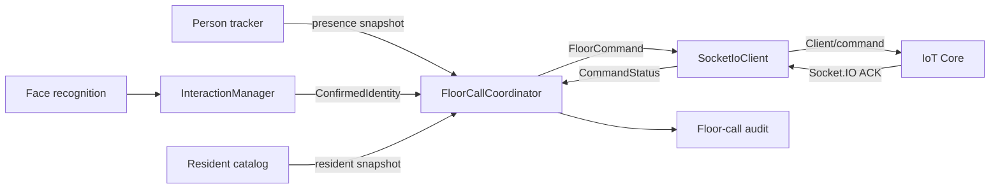
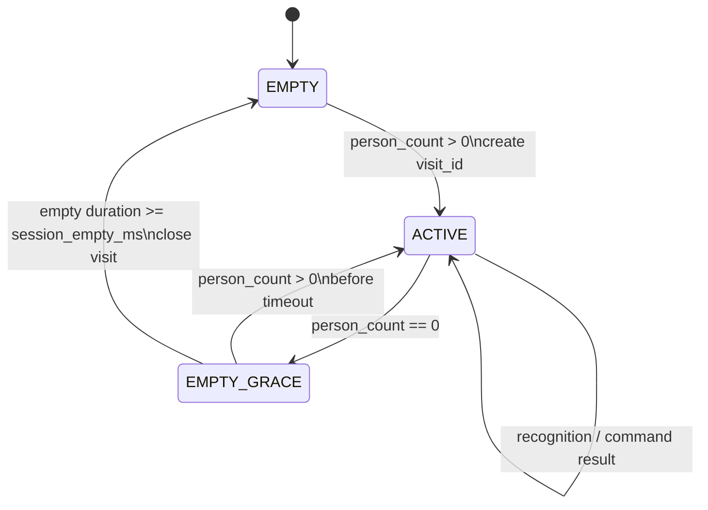
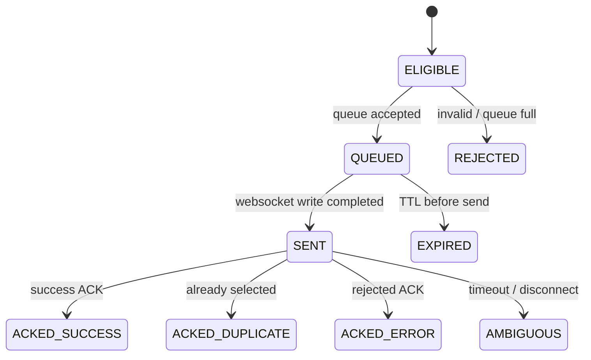

# Design: Điều phối gọi tầng tự động

Trạng thái: **Draft**
Tài liệu yêu cầu: [requirements.md](requirements.md)

## 1. Kiến trúc



`InteractionManager` không quyết định gọi tầng. Nó chỉ phát `ConfirmedIdentity`. Coordinator giữ
ngữ cảnh phiên cabin và áp dụng policy. `SocketIoClient` chỉ chịu trách nhiệm transport, ACK và
reconnect.

## 2. Mô hình dữ liệu đề xuất

```cpp
using VisitId = std::uint64_t;

struct PresenceSnapshot {
    double now_ms;
    std::vector<int> active_person_track_ids; // gồm tracked và lost còn trong grace
};

struct ConfirmedIdentity {
    int subject_key;
    std::int64_t resident_id;
    int home_floor;
    float similarity;
    double confirmed_at_ms;
    std::uint64_t catalog_generation;
};

enum class FloorCommandState {
    ELIGIBLE,
    QUEUED,
    SENT,
    ACKED_SUCCESS,
    ACKED_DUPLICATE,
    ACKED_ERROR,
    EXPIRED,
    AMBIGUOUS,
    SUPPRESSED,
    REJECTED,
};

struct FloorCommand {
    VisitId visit_id;
    std::uint64_t sequence;
    std::string request_id;
    std::int64_t resident_id;
    int subject_key;
    int floor;
    std::int64_t value;
    float similarity;
    double created_at_ms;
    FloorCommandState state;
    std::string reason;
};

struct TransportResult {
    std::string request_id;
    int socket_ack_id;
    enum Kind { SENT, SUCCESS, DUPLICATE, ERROR, EXPIRED, AMBIGUOUS } kind;
    std::string code;
    std::string message;
    bool retryable;
};
```

Transport queue phải chứa `FloorCommand`, không chỉ `floor`, để callback luôn tương quan đúng lệnh.

## 3. State machine phiên cabin



State phiên:

```cpp
struct CabinVisit {
    VisitId id = 0;
    double started_at_ms = 0;
    std::optional<double> empty_since_ms;
    std::unordered_map<std::int64_t, ResidentDecision> resident_decisions;
    std::unordered_map<int, std::string> floor_request_ids;
    std::unordered_map<std::string, FloorCommand> commands;
    std::uint64_t next_sequence = 1;
};
```

### Nguồn presence

Presence phải lấy từ person tracker, không lấy từ số khuôn mặt trong frame. Một người quay mặt đi vẫn
ở cabin và không được làm kết thúc phiên. Track `Lost` còn trong `track_lost_ms` vẫn tính là hiện diện.

Nếu tracker chưa cung cấp person snapshot đáng tin cậy, bản đầu có thể dùng tập active track hiện có,
nhưng phải đặt `session_empty_ms` lớn hơn `track_lost_ms`. Điều kiện cấu hình:

```text
session_empty_ms >= track_lost_ms
```

Đề xuất thực tế: `track_lost_ms` theo tracker spec và `session_empty_ms=5000`.

## 4. Luồng xử lý confirmed identity

Coordinator chạy thuật toán thuần trạng thái, không I/O:

```text
on_confirmed(identity):
  ensure an ACTIVE visit exists

  if resident_id already exists in resident_decisions:
      emit SUPPRESSED_SAME_RESIDENT
      return

  snapshot resident decision immediately

  if resident missing/inactive:
      finalize REJECTED_RESIDENT
      return
  if home_floor <= 0:
      finalize SUPPRESSED_NO_FLOOR
      return
  if home_floor outside cabin range or cannot be encoded:
      finalize REJECTED_INVALID_FLOOR
      return
  if automatic floor calls are inhibited:
      finalize SUPPRESSED_POLICY
      return
  if floor exists in floor_request_ids:
      finalize SUPPRESSED_SAME_FLOOR, reference existing request_id
      return

  create unique request_id and immutable FloorCommand snapshot
  reserve resident_id and floor inside visit
  enqueue to SocketIoClient

  if enqueue succeeds:
      transition ELIGIBLE -> QUEUED
  else:
      transition ELIGIBLE -> REJECTED_QUEUE_FULL
      release floor reservation only if transport proves command was never accepted
```

Resident decision được ghi trước khi trả về để hai recognition gần nhau không thể cùng qua gate.

### Thứ tự deterministic

Main gom các outcome trong cùng một frame rồi sort theo:

1. `confirmed_at_ms` tăng dần;
2. `resident_id` tăng dần;
3. `subject_key` tăng dần.

Sau đó mới gọi coordinator. Điều này làm test ổn định dù container/track có thứ tự khác nhau.

## 5. Dedupe

Hai khóa phục vụ hai mục đích khác nhau:

- `resident_decisions[resident_id]`: chống một cư dân gọi lại do track split hoặc recognition lặp.
- `floor_request_ids[floor]`: gộp nhiều cư dân cùng tầng.

Không xóa hai khóa này khi khuôn mặt biến mất, track đổi ID, cooldown kết thúc hoặc command ACK lỗi.
Chúng chỉ được xóa khi phiên cabin kết thúc. Trường hợp enqueue chắc chắn thất bại trước send có thể
giải phóng khóa tầng để một yêu cầu khác thử lại, nhưng vẫn giữ quyết định của resident đầu tiên để
không tạo vòng lặp mỗi frame.

## 6. State machine command



`SocketIoClient` phát callback cho mọi transition mà nó sở hữu. Coordinator cập nhật snapshot và đẩy
audit record sang một queue riêng nếu DB write có thể chặn.

### Quy tắc thành công

- `ACKED_SUCCESS`: IoT Core xác nhận thao tác write/select-floor thành công.
- `ACKED_DUPLICATE`: IoT Core xác nhận tầng đã được chọn; kết quả hành vi tương đương thành công.
- `SENT` không phải thành công.
- ACK có đúng `ack_id` nhưng không parse được payload phải là `ACKED_ERROR` với code
  `MALFORMED_ACK`, không được tăng metric success.

### Timeout và reconnect

- `QUEUED` quá `command_ttl_ms`: `EXPIRED`.
- Mất kết nối khi chưa send: giữ queue nếu còn TTL.
- Mất kết nối hoặc timeout sau send: `AMBIGUOUS`.
- Không retry `AMBIGUOUS` với `requestId` cố định hoặc khi IoT Core chưa cam kết idempotency.
- Sau khi có unique request ID và server dedupe, retry giữ nguyên `request_id`, tạo Socket.IO ack id
  mới và giới hạn số lần.

## 7. Protocol Socket.IO

Payload mục tiêu:

```text
42<ack_id>["Client/command",{
  "action":"write",
  "deviceCode":"2026010900100098",
  "address":"8193-2",
  "value":32,
  "requestId":"ai-core:<cabin_id>:<visit_id>:<sequence>"
}]
```

Ví dụ floor 5 có `value=32`. `ack_id` thuộc phạm vi connection; `requestId` thuộc phạm vi nghiệp vụ.

ACK cần được chốt với IoT Core. Schema đề xuất:

```json
{
  "requestId": "ai-core:2:104:1",
  "success": true,
  "code": "OK",
  "message": "floor selected"
}
```

Các code tối thiểu:

| Code | Phân loại | Retry |
|---|---|---|
| `OK` | `ACKED_SUCCESS` | Không |
| `ALREADY_SELECTED` | `ACKED_DUPLICATE` | Không |
| `INVALID_ADDRESS` | `ACKED_ERROR` | Không |
| `INVALID_VALUE` | `ACKED_ERROR` | Không |
| `DEVICE_OFFLINE` | `ACKED_ERROR` | Có, khi idempotency đã hỗ trợ |
| `FORBIDDEN_MODE` | `ACKED_ERROR` | Không |

## 8. Semantics register và nhiều tầng

Board đã được xác nhận giữ các tầng đã chọn qua nhiều write. Mỗi write `2^floor` có nghĩa là set thêm
tầng tương ứng, không thay thế toàn bộ bitmask hiện có.

Do đó AI Core gửi từng tầng thành một command riêng:

```text
floor 5 -> write 32 -> ACK
floor 6 -> write 64 -> ACK
```

Sau hai write, board giữ cả tầng 5 và tầng 6. AI Core không cần đọc register, tự OR bit hoặc gửi lại
giá trị tổng `96`. Cơ chế FIFO và một command in-flight vẫn được giữ để ACK luôn tương quan rõ ràng.

## 9. Tích hợp với code hiện tại

### `InteractionManager`

Giữ nhiệm vụ confirm danh tính. Cần sửa lỗi identity đã `CONFIRMED` bị reset về `DETECTING` khi một
frame không match nếu tracker đã latch danh tính. Cách ưu tiên:

- main truyền identity latched của person track vào interaction;
- sau `CONFIRMED`, interaction không phát confirmed lần nữa cho session đó;
- catalog invalidation/admin reset mới được phép xóa identity latch theo rule tracker spec.

### `main.cpp`

Thay đoạn gọi trực tiếp:

```cpp
iot_socket->send_floor(hf);
```

bằng:

```cpp
floor_coordinator.on_confirmed(confirmed_identity);
```

Mỗi frame, main cũng gọi:

```cpp
floor_coordinator.on_presence(presence_snapshot);
```

Không gán `match_events.floor_selected` chỉ vì queue nhận lệnh. Có thể giữ `match_events` cho nhận
diện và tạo bảng/event stream riêng cho floor-call lifecycle.

### `SocketIoClient`

API đích:

```cpp
using StatusCallback = std::function<void(const TransportResult&)>;

bool enqueue(FloorTransportCommand command);
void set_status_callback(StatusCallback callback);
```

Queue giữ request ID và metadata. Callback được gọi sau khi đã nhả mutex nội bộ.

## 10. Lưu audit

Đề xuất bảng riêng thay vì overload `match_events`:

```sql
CREATE TABLE floor_call_events (
    id              bigserial PRIMARY KEY,
    cabin_id        integer NOT NULL,
    visit_id        bigint NOT NULL,
    request_id      text NOT NULL,
    resident_id     bigint NULL,
    floor           integer NULL,
    register_value  bigint NULL,
    state           text NOT NULL,
    reason          text NULL,
    ack_code        text NULL,
    created_at      timestamptz NOT NULL DEFAULT now(),
    UNIQUE (request_id, state)
);
```

Nếu chưa muốn migration DB, giai đoạn đầu ghi structured log. Không dùng
`match_events.floor_selected` làm bằng chứng board đã nhận lệnh.

## 11. Cấu hình đề xuất

| Cấu hình | Mặc định | Ý nghĩa |
|---|---:|---|
| `floor_call_enabled` | `false` khi rollout | Bật gửi command thật |
| `floor_call_shadow` | `true` | Chạy logic và log nhưng không gửi |
| `floor_session_empty_ms` | `5000` | Cabin trống bao lâu thì đóng phiên |
| `floor_command_ttl_ms` | `5000` | Tuổi tối đa trước send |
| `floor_ack_timeout_ms` | `3000` | Chờ ACK sau send |
| `floor_dedupe_by_floor` | `true` | Gộp cư dân cùng tầng |
| `floor_max_commands_per_visit` | `16` | Giới hạn lỗi dữ liệu/recognition |
| `floor_retry_count` | `0` | Chỉ tăng sau khi server có idempotency |

`floor_call_enabled` và `floor_call_shadow` không cùng bật. Khi shadow, coordinator vẫn sinh đầy đủ
decision/audit nhưng transport không gửi.

## 12. Chính sách dữ liệu từ IoT Core

Phiên bản đầu không cần đọc raw board register để gọi một tầng. AI Core cần:

1. ACK nghiệp vụ cho command do chính AI gửi.
2. Sau này, một event chuẩn hóa về `service_mode`, `door_state`, `current_floor` nếu nghiệp vụ yêu cầu
   chặn gọi trong emergency/maintenance hoặc dùng door cycle làm biên phiên.

AI Core không nên phụ thuộc trực tiếp vào địa chỉ register đầu vào của từng board. IoT Core nên chuyển
chúng thành event có schema ổn định.

## 13. Rollout

1. **Shadow:** chạy coordinator, log `WOULD_CALL`, không gửi; kiểm tra duplicate và biên phiên bằng
   video thực tế.
2. **Một người:** bật command thật cho một cabin, xác nhận ACK success và audit.
3. **Nhiều người cùng tầng:** xác nhận chỉ một write.
4. **Nhiều người khác tầng:** gửi tuần tự từng tầng và xác nhận board giữ tất cả tầng đã chọn.
5. **Fault injection:** socket offline, ACK lỗi, timeout, disconnect sau send, queue đầy.
6. **Theo dõi:** so sánh command success với thao tác board trong nhiều phiên trước khi bật mặc định.
