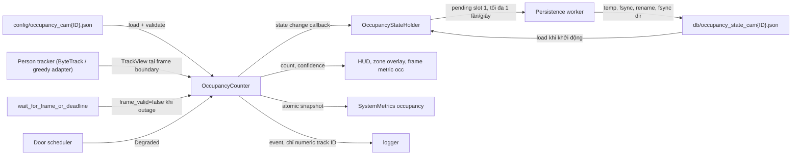

# Thiết kế: Đếm người trong cabin bằng Counting Zone

Tài liệu yêu cầu: [requirements.md](requirements.md). Trạng thái bàn giao: [handoff.md](handoff.md).

## Overview

Camera cabin có góc chết và không bao phủ toàn bộ cabin, nên số người detect trong một frame không phải là số người hiện tại. Thiết kế này đếm theo sự kiện: mỗi person track được theo dõi khi điểm chân của nó đi qua một counting zone đặt ở cửa thang máy, và chỉ crossing hợp lệ mới làm count tăng hoặc giảm.

Các quyết định chính:

- Đếm event-based theo `track.id`, dùng bottom-center của bbox làm điểm tham chiếu.
- Không tự reset count khi mất track, outage hay cửa đóng. Khi không chắc, counter giữ count và chuyển confidence sang `Uncertain`; chỉ crossing hợp lệ hoặc `reconcile` mới đưa về `Certain`.
- Chống double count khi ID churn bằng ghost ngắn hạn và occupancy slot gắn với từng track.
- Persistence chạy trên worker riêng với pending slot dung lượng 1; frame thread không làm disk I/O.
- Tính năng opt-in qua `--occupancy-config`. Khi tắt hoặc khởi tạo lỗi, app chạy như trước và không hiển thị occupancy.

### Phạm vi v1

V1 chỉ hỗ trợ **đúng một counting zone cho mỗi camera**. File JSON vẫn dùng mảng `zones` để giữ khả năng mở rộng định dạng, nhưng validator từ chối rõ ràng khi mảng có 0 hoặc nhiều hơn 1 phần tử. Runtime không bao giờ âm thầm dùng `zones.front()` khi cấu hình có nhiều zone.

## Architecture



### State machine mỗi track

Điểm tham chiếu là bottom-center của bbox. Polygon và vector hướng vào cabin chia không gian thành:

- `-1`: phía ngoài cabin;
- `0`: trong counting zone hoặc dải sticky cạnh zone;
- `+1`: phía trong cabin.

Các transition chính:

- outside → zone: bắt đầu entry candidate;
- entry candidate → inside đủ displacement: phát Entry, tăng count và chuyển `Certain`;
- inside → zone: bắt đầu exit candidate;
- exit candidate → outside đủ displacement: chỉ phát Exit và giảm count khi track đang giữ một occupancy slot đã được gán; track xuất hiện phía trong mà không có Entry/slot tương ứng chỉ giữ count, chuyển `Uncertain` và không phát event;
- candidate quay lại cùng phía: không đếm và chuyển `Uncertain`; candidate đi ra ngoài polygon qua dải sticky theo phương ngang vẫn được giữ cho đến khi projection xác nhận phía cuối, tránh hủy crossing hợp lệ ở polygon phối cảnh;
- mất track trong zone, mất track phía trong, observation prediction-only, door scheduler `Degraded`, frame invalid/RTSP outage hoặc ID churn mơ hồ: giữ nguyên count và chuyển `Uncertain`.

Do capture thread dùng latest-frame slot, live RTSP có thể bỏ frame trung gian khi inference chậm hơn camera. Nếu hai observation liên tiếp nhảy trực tiếp `outside ↔ inside`, counter kiểm tra đoạn nối hai điểm chân có thật sự cắt polygon và displacement có đạt ngưỡng hay không. Đoạn cắt hợp lệ được xử lý như crossing bình thường; đổi phía nhưng đi vòng ngoài polygon chỉ chuyển `Uncertain`, không phát event. Vì vậy replay đủ frame và live stream drop frame giữ cùng semantics.

ByteTrack vẫn giữ `confirm_hits=3` để chống detection nhiễu, nhưng `TrackView` của track đã xác nhận mang thêm bbox/timestamp của observation tentative đầu tiên. Trong tối đa 1 giây sau observation đầu, khi counter lần đầu nhận track đã xác nhận, nó khởi tạo state từ điểm chân đầu tiên rồi xử lý vị trí hiện tại như một transition bình thường. Nhờ vậy quỹ đạo `tentative outside → tentative zone → confirmed inside` hoặc `tentative outside → confirmed inside` vẫn tạo Entry; lịch sử cũ hơn 1 giây bị bỏ qua để không replay crossing sau reactivation/ghost expiry.

Ghost sống 500 ms kể từ lúc runtime phát hiện track biến mất. Nếu ID cũ và đúng một ID mới ở gần xuất hiện trong cùng frame boundary, counter chuyển state trực tiếp trước khi xử lý loss nên giữ nguyên count, confidence và không phát callback thừa. Sau khi đã thành ghost, một ID mới chỉ kế thừa khi có đúng một ghost phù hợp trong khoảng cách cho phép; nhiều predecessor/successor hoặc nhiều ghost phù hợp được coi là mơ hồ. Trường hợp một predecessor tách thành nhiều successor được phát hiện trước khi tạo/tiêu thụ ghost: confidence chuyển `Uncertain`, các lineage successor bị chặn phát crossing event trong vòng đời hiện tại để không nhân đôi count, và callback persistence chỉ chạy khi trạng thái thực sự đổi. Track mới không kế thừa ghost mà lần đầu xuất hiện trong zone hoặc phía cabin cũng chuyển `Uncertain`, giữ nguyên count và không tự tạo entry. Crossing hợp lệ từ lineage tin cậy hoặc `reconcile` đưa confidence về `Certain`.

Mỗi track còn giữ cờ gán occupancy riêng. Entry hợp lệ tạo đúng một slot gắn với track; chỉ track/ghost kế thừa slot đó mới được decrement và phát Exit. Count phục hồi từ state bắt đầu dưới dạng các slot chưa gán, có thể gán cho track đầu tiên quan sát đáng tin cậy ở phía trong cabin; slot của ghost hết hạn được trả về nhóm chưa gán. Nhờ vậy track mới xuất hiện phía trong khi count bằng 0, hoặc track phụ xuất hiện cạnh một người đã được đếm, không thể phát nhiều Exit hay trừ occupancy của track khác.

### Tích hợp main

Occupancy chỉ được khởi tạo sau khi person tracker đã hợp lệ và config load/validate thành công. `env.sh` tạo config/state path từ `FACE_CABIN_ID`, chỉ bật nếu config tồn tại và truyền nguyên mảng `occupancy_args` có quote vào app.

Main loop ghép deadline occupancy tối đa 1 giây vào `wait_for_frame_or_deadline`. Tại mọi nhánh không có frame hoặc frame rỗng, counter nhận `frame_valid=false` trước `continue`; outage kéo dài vì vậy chuyển sang `Uncertain` mà không reset count. Với frame hợp lệ, update chạy sau `active_tracks()` tại frame boundary và nhận cả `predicted_only` lẫn cờ door degraded. Adapter greedy đánh dấu prediction-only khi track không được quan sát trong frame hiện tại, gồm frame bỏ qua detector và detection miss khi track vẫn còn confirmed.

HUD, polygon/direction overlay, frame metric `occ` và system metric `occupancy` chỉ xuất hiện khi feature enable thành công. System metrics đóng gói enabled/count/confidence vào một atomic snapshot duy nhất để worker không đọc cặp count/confidence bị xé. Shutdown enqueue snapshot cuối rồi flush/join worker trước khi logger dừng. Log event occupancy chỉ chứa numeric track ID.

## Components and Interfaces

### `occupancy_config`

Định nghĩa `OccupancyConfig` và `CountingZone`, parse/serialize JSON tối thiểu, validate và đổi tọa độ chuẩn hóa sang pixel.

```cpp
bool load_occupancy_config(const std::string& path, OccupancyConfig& out, std::string& error);
bool save_occupancy_config(const std::string& path, const OccupancyConfig& cfg, std::string& error);
bool validate_occupancy_config(const OccupancyConfig& cfg, std::string& error);
std::vector<cv::Point> zone_to_pixels(const CountingZone& zone, int frame_w, int frame_h);
void set_occupancy_config_save_failure_for_test(AtomicSaveFailurePoint point);
```

Parser số JSON không ném exception khi gặp exponent malformed hoặc overflow. Save config dùng file tạm duy nhất, ghi đầy đủ, `fsync`, đóng, `rename` và `fsync` thư mục; target hợp lệ không bị thay thế nếu lỗi xảy ra trước `rename`.

### `occupancy_state`

Giữ `OccupancyState` (`count`, `confidence`, `generation`, `saved_at_ms`) và worker persistence bất đồng bộ.

```cpp
class OccupancyStateHolder {
public:
    explicit OccupancyStateHolder(std::string path);
    bool load(std::string& error, OccupancyLoadStatus* status = nullptr);
    bool save(std::string& error);          // đồng bộ, chỉ dùng cho setup/tool/test
    void request_save(int count, OccupancyConfidence confidence);
    void close();
    void set(int count, OccupancyConfidence confidence);
    void mark_uncertain(const char* reason);
    OccupancyState get() const;
};
```

`OccupancyStateHolder::load` validate đầy đủ version, count không âm, confidence, generation không âm và timestamp hữu hạn. File thiếu hoặc invalid đều reset về `count=0`, `Uncertain`, trả status quan sát được và log warning qua `src/log/logger.h` mà không ghi PII.

`request_save` không làm disk I/O trên frame thread. Nó cập nhật snapshot trong một pending slot dung lượng 1; request mới thay snapshot cũ (bounded/drop-oldest). Worker riêng ghi snapshot mới nhất tối đa một lần mỗi giây bằng chuỗi: mở và kiểm tra thư mục cha trước khi thay target → temp duy nhất → write đầy đủ → `fsync` file → close → `rename` → bắt buộc `fsync` directory đã mở. Lỗi trước rename giữ nguyên target và cleanup temp; lỗi mở/fsync directory được trả về thay vì báo thành công. `close()` flush pending snapshot theo throttle rồi join worker an toàn. Validated entry/exit, mọi thay đổi confidence và cả `reconcile(count)`/`reconcile_empty()` đều đi qua callback để schedule persistence.

### `occupancy_counter`

State machine theo `track.id`, phát `OccupancyEvent`, quản lý ghost ngắn hạn chống ID churn và callback mỗi khi trạng thái cần persistence. Hành vi chi tiết nằm ở mục "State machine mỗi track" trong Architecture.

```cpp
using OccupancyStateChangeCallback = std::function<void(int, OccupancyConfidence)>;
using OccupancyTrackTraceCallback  = std::function<void(int, int, int, bool, bool)>;

class OccupancyCounter {
public:
    OccupancyCounter(OccupancyConfig cfg, OccupancyState initial_state,
                     OccupancyStateChangeCallback state_change = {},
                     OccupancyTrackTraceCallback  track_trace  = {});
    OccupancySnapshot update(const std::vector<TrackView>& tracks, int frame_w, int frame_h,
                             double timestamp_ms, bool frame_valid, bool tracking_unreliable);
    void reconcile(int count);
    void reconcile_empty();
};
```

- `update` chạy trên frame thread tại frame boundary. `tracking_unreliable` là cờ door scheduler `Degraded`.
- `state_change` được gọi khi count hoặc confidence đổi; main nối nó tới `OccupancyStateHolder::request_save`.
- `track_trace` nhận `track_id`, side cũ, side mới, cờ in-zone và cờ khởi tạo từ first observation; main chỉ dùng cho log debug `occupancy-track` với numeric ID.
- `reconcile(count)` kẹp count âm về 0, đặt `Certain`, xóa toàn bộ track/ghost, coi mọi slot là chưa gán và luôn gọi `state_change`. `reconcile_empty()` tương đương `reconcile(0)`.

### `app_config`, `env.sh`

Bật tính năng bằng `--occupancy-config`; `--occupancy-state` là tùy chọn và mặc định thành `<config>.state`.

- `resolve_occupancy_state_path(cfg)` trả chuỗi rỗng khi tính năng tắt, path explicit nếu có, ngược lại `<occupancy-config>.state`.
- `parse_args` từ chối path rỗng hoặc bắt đầu bằng `-`, `--occupancy-state` khi thiếu `--occupancy-config`, và `--occupancy-config` khi thiếu `--person-model`.
- `env.sh` dùng `$FACE_OCCUPANCY_CONFIG_DIR/occupancy_cam$FACE_CABIN_ID.json` (mặc định `config/`) và `$FACE_OCCUPANCY_STATE_DIR/occupancy_state_cam$FACE_CABIN_ID.json` (mặc định `db/`), luôn truyền cả hai option khi file config tồn tại.

### `overlay`, `system_metrics`

Chỉ hiển thị/phát occupancy khi tính năng đã được khởi tạo thành công.

```cpp
void append_occupancy_hud(char* hud, std::size_t capacity, bool enabled, int count, bool uncertain);
void draw_counting_zones(cv::Mat& frame, const OccupancyConfig& config, int frame_w, int frame_h,
                         const UiScale& ui);

void                    SystemMetrics::set_occupancy(int count, bool uncertain);
SystemOccupancySnapshot SystemMetrics::occupancy_snapshot() const;
```

## Data Models

### Config JSON v1

JSON v1 có `version`, `reference_width`, `reference_height` và đúng một phần tử trong `zones`. Mỗi zone có tên, polygon ít nhất 3 điểm với diện tích khác 0, `inside_direction_degrees` hữu hạn trong `[0, 360)` và `min_crossing_displacement` hữu hạn trong `[0, 1]`. Mọi tọa độ phải hữu hạn và nằm trong `[0, 1]`; các trường nguyên không chấp nhận số thập phân hoặc số vượt miền.

| Trường | Kiểu C++ | Ràng buộc |
|---|---|---|
| `version` | `int` | Bằng `OccupancyConfig::CURRENT_VERSION` (`1`) |
| `reference_width`, `reference_height` | `int` | Nguyên dương |
| `zones` | `std::vector<CountingZone>` | Đúng 1 phần tử |
| `zones[].name` | `std::string` | Không rỗng |
| `zones[].polygon` | `std::vector<PointF>` | ≥ 3 điểm, diện tích khác 0, `x`/`y` hữu hạn trong `[0, 1]` |
| `zones[].inside_direction_degrees` | `float` | Hữu hạn, `[0, 360)`; vector chỉ vào cabin |
| `zones[].min_crossing_displacement` | `float` | Hữu hạn, `[0, 1]`, theo tọa độ chuẩn hóa |

```json
{
  "version": 1,
  "reference_width": 1920,
  "reference_height": 1080,
  "zones": [
    {
      "name": "cabin-door",
      "polygon": [
        { "x": 0.469727, "y": 0.602431 },
        { "x": 0.290039, "y": 0.725694 },
        { "x": 0.324219, "y": 0.935764 },
        { "x": 0.542969, "y": 0.770833 }
      ],
      "inside_direction_degrees": 68,
      "min_crossing_displacement": 0.05
    }
  ]
}
```

### State JSON

| Trường | Kiểu C++ | Ý nghĩa |
|---|---|---|
| `version` | (chỉ trong file) | Bằng `1` |
| `count` | `int` | Không âm |
| `confidence` | `OccupancyConfidence` | Chuỗi `"certain"` hoặc `"uncertain"` |
| `generation` | `int64_t` | Không âm; tăng mỗi lần holder cập nhật state |
| `saved_at_ms` | `double` | Wall clock lúc state đổi; `-1` khi chưa từng lưu |

`saved_at_ms` dùng wall clock để có ý nghĩa sau restart; timestamp dùng cho tracking vẫn là steady clock.

```json
{
  "confidence": "uncertain",
  "count": 0,
  "generation": 5,
  "saved_at_ms": 1793084880000,
  "version": 1
}
```

`OccupancyLoadStatus` báo kết quả load: `Loaded`, `Missing` hoặc `Invalid`.

### Input và output của counter

- `TrackView` (từ `tracker_types.h`): counter dùng `id`, `state`, `box`, `predicted_only` và bộ `first_observation_box`/`first_observation_ms`/`has_first_observation` cho observation tentative đầu tiên.
- `OccupancyEvent`: `direction` (`Entry` hoặc `Exit`), `track_id`, `timestamp_ms`.
- `OccupancySnapshot`: `count`, `confidence`, danh sách `events` của lần update và `pipeline_unreliable` (frame invalid, geometry zone không hợp lệ, door degraded hoặc có observation prediction-only).
- `SystemOccupancySnapshot`: `enabled`, `count`, `uncertain`, lưu trong một `std::atomic<uint64_t>` duy nhất.

### State nội bộ của counter

- `TrackState` theo `track.id`: side hiện tại, cờ in-zone, entry/exit candidate, `crossing_suppressed` cho lineage mơ hồ, `occupancy_assigned`, projection lúc bắt đầu candidate và cực trị, điểm chân chuẩn hóa cuối cùng, `last_seen_ms`.
- `Ghost`: bản sao state của track vừa mất (gồm `occupancy_assigned`) cùng `expired_at_ms`.
- `unassigned_occupants_`: số slot chưa gán, khởi tạo từ count phục hồi.
- Hằng số: ghost timeout `500 ms`, tuổi tối đa của first observation `1000 ms`, khoảng cách kế thừa ghost `0.05` theo tọa độ chuẩn hóa.

## Correctness Properties

*Property là đặc tính phải đúng trên mọi lần chạy hợp lệ của hệ thống, tức một phát biểu hình thức về việc hệ thống phải làm gì. Property là cầu nối giữa đặc tả đọc được và kiểm chứng tự động.*

Trong dòng **Validates**, `X.Y` là `Requirement X` ý thứ `Y` ở mục "Requirements" của [requirements.md](requirements.md) (ví dụ `3.2` là Requirement 3 "Chống drift và xử lý bất định", ý 2).

### Property 1: Count chỉ đổi qua event hợp lệ hoặc reconcile

*Với mọi* chuỗi input của `update`, count chỉ tăng 1 khi phát Entry, giảm 1 khi phát Exit, hoặc được đặt bởi `reconcile(count)`/`reconcile_empty()`. Mất track, timeout, outage, observation prediction-only, door `Degraded` hay cửa đóng không bao giờ đổi count. Count không bao giờ âm.

**Validates: Requirements 2.2, 2.3, 2.5, 3.1, 5.4**

### Property 2: Crossing bị abort không được đếm

*Với mọi* track bắt đầu entry hoặc exit candidate rồi quay lại cùng phía ban đầu, counter không phát event, giữ count và chuyển `Uncertain`. Candidate đi qua dải sticky theo phương ngang không bị hủy cho đến khi projection xác nhận phía cuối.

**Validates: Requirements 2.4, 3.2**

### Property 3: Bỏ frame không đổi semantics

*Với mọi* cặp observation liên tiếp nhảy trực tiếp `outside ↔ inside`, counter phát crossing khi và chỉ khi đoạn nối hai điểm chân cắt polygon và displacement đạt ngưỡng; nếu không, counter chỉ chuyển `Uncertain`. Nhờ đó replay đủ frame và live stream bị drop frame cho cùng kết quả với cùng quỹ đạo.

**Validates: Requirements 2.2, 2.3**

### Property 4: Track tentative không làm mất Entry

*Với mọi* track đã xác nhận có first observation không cũ hơn 1 giây, counter khởi tạo state từ điểm chân đầu tiên, nên quỹ đạo `tentative outside → confirmed inside` vẫn tạo Entry. First observation cũ hơn 1 giây bị bỏ qua và không replay crossing.

**Validates: Requirements 2.1, 2.2**

### Property 5: Exit chỉ trả slot đã gán

*Với mọi* chuỗi event, mỗi Entry tạo đúng một slot gắn với track, và Exit chỉ phát từ track/ghost đang giữ slot. Track không giữ slot đi ra ngoài không phát Exit, không đổi count và chuyển `Uncertain`. Số Exit không vượt quá số slot đã gán, kể cả slot phục hồi từ state.

**Validates: Requirements 2.3, 3.4**

### Property 6: ID churn không double count

*Với mọi* thay đổi track ID: handoff rõ ràng một-một (trong cùng frame boundary, hoặc qua đúng một ghost phù hợp trong 500 ms) giữ nguyên count, confidence và không gọi callback thừa. Handoff mơ hồ (nhiều predecessor, successor hoặc ghost phù hợp) chuyển `Uncertain` và chặn crossing event của các lineage successor trong vòng đời hiện tại. Track mới không kế thừa ghost mà xuất hiện lần đầu trong zone hoặc phía cabin chuyển `Uncertain` và không tạo Entry.

**Validates: Requirements 3.2, 3.4**

### Property 7: Chuyển confidence

*Với mọi* chuỗi input, confidence chuyển `Uncertain` khi mất track trong zone hoặc phía trong, khi có observation prediction-only, door `Degraded`, frame invalid, ID churn mơ hồ hoặc crossing bị abort. Confidence chỉ về `Certain` khi có crossing hợp lệ từ lineage tin cậy hoặc `reconcile`. `state_change` được gọi mỗi khi count hoặc confidence đổi và mỗi lần `reconcile`.

**Validates: Requirements 3.2, 3.3**

### Property 8: Validate config

*Với mọi* file config, `load_occupancy_config` thành công khi và chỉ khi mọi ràng buộc ở bảng Config JSON v1 đều thỏa. Parser không ném exception với bất kỳ input nào, gồm exponent malformed, overflow và số thập phân ở trường nguyên. Save rồi load một config hợp lệ cho lại cùng config.

**Validates: Requirements 1.1, 1.2, 1.3**

### Property 9: Ghi atomic không clobber

*Với cả* config và state, lỗi ở bất kỳ bước nào trước `rename` (mở temp, write, `fsync`, close, `rename`) giữ nguyên nội dung target cũ và không để lại file temp. Lỗi mở hoặc `fsync` thư mục được trả về như lỗi, không báo thành công.

**Validates: Requirements 1.4, 4.2**

### Property 10: Persistence round-trip và phục hồi

*Với mọi* `OccupancyState` hợp lệ, save rồi load trả lại cùng `count`, `confidence`, `generation` và `saved_at_ms`. File thiếu hoặc invalid luôn cho `count=0`, `Uncertain`, status `Missing`/`Invalid` và một warning không chứa PII.

**Validates: Requirements 4.1, 4.3**

### Property 11: Frame thread không làm disk I/O

*Với mọi* chuỗi `request_save`, frame thread chỉ cập nhật pending slot dung lượng 1 và snapshot mới thay snapshot cũ. Worker ghi tối đa một lần mỗi giây và luôn ghi snapshot mới nhất tại thời điểm ghi. `close()` flush snapshot cuối trước khi join worker.

**Validates: Requirements 4.1, 4.2**

### Property 12: Output chỉ khi feature bật, không PII

HUD, zone overlay, frame metric `occ` và system metric `occupancy` xuất hiện khi và chỉ khi counter khởi tạo thành công. System metrics đọc enabled/count/confidence từ một atomic snapshot nên không bao giờ thấy cặp count/confidence bị xé. Log occupancy chỉ chứa numeric track ID.

**Validates: Requirements 5.3**

### Property 13: Bật tính năng và đường dẫn

`resolve_occupancy_state_path` trả rỗng khi tính năng tắt, path explicit khi có, ngược lại `<config>.state`. `env.sh` dựng path từ `FACE_CABIN_ID`, giữ nguyên path có khoảng trắng khi truyền vào argv, và chỉ truyền option occupancy khi file config tồn tại.

**Validates: Requirements 5.1, 5.2**

## Error Handling

Nguyên tắc: lỗi occupancy không dừng pipeline nhận diện và không chặn frame loop. Lỗi đi theo convention của repo (`bool` + `std::string& error` + log qua `src/log/logger.h`), không throw. Khi không chắc chắn, counter giữ count và chuyển `Uncertain` thay vì đoán.

| Tình huống | Xử lý |
|---|---|
| `--occupancy-config`/`--occupancy-state` thiếu path, path rỗng hoặc bắt đầu bằng `-` | `parse_args` in lỗi ra stderr, đặt `invalid_args`; app không chạy |
| `--occupancy-state` không có `--occupancy-config` | Như trên |
| `--occupancy-config` không có `--person-model` | Như trên |
| `env.sh` không tìm thấy file config của cabin | Không truyền `occupancy_args`; tính năng tắt |
| Person tracker không khởi tạo được | Không khởi tạo occupancy |
| Config không mở được, JSON lỗi, sai version, 0 hoặc nhiều hơn 1 zone, giá trị ngoài miền | `load_occupancy_config` trả `false` kèm error; main log `WARN occupancy config load failed`, tắt tính năng và tiếp tục chạy không có HUD/overlay/metric occupancy |
| Số JSON có exponent malformed, overflow hoặc thập phân ở trường nguyên | Parser trả lỗi validate, không ném exception |
| State file thiếu | `count=0`, `Uncertain`, status `Missing`, log warning |
| State file invalid | `count=0`, `Uncertain`, status `Invalid`, log warning |
| Lỗi trước `rename` khi lưu config/state | Giữ nguyên target, xóa temp, trả error |
| Lỗi mở hoặc `fsync` thư mục | Trả error, không báo thành công |
| Worker lưu state thất bại | Log `WARN occupancy state persistence failed`; snapshot đó không retry, request kế tiếp ghi snapshot mới nhất |
| `request_save` dồn dập | Pending slot bị ghi đè (drop-oldest); worker ghi tối đa một lần mỗi giây |
| Không có frame, frame rỗng hoặc RTSP outage | `update(frame_valid=false)` tại deadline tối đa 1 giây; giữ count, chuyển `Uncertain` |
| Observation prediction-only hoặc door `Degraded` | Giữ count, chuyển `Uncertain` |
| Mất track trong zone hoặc phía trong | Giữ count, chuyển `Uncertain`; track thành ghost 500 ms, ghost hết hạn trả slot về nhóm chưa gán |
| Candidate quay lại cùng phía | Không phát event, chuyển `Uncertain` |
| Nhảy `outside ↔ inside` nhưng đoạn nối không cắt polygon | Không phát event, chuyển `Uncertain` |
| ID churn mơ hồ | Chuyển `Uncertain`, chặn crossing event của lineage successor |
| Track mới xuất hiện trong zone hoặc phía trong mà không kế thừa ghost | Giữ count, chuyển `Uncertain`, không tạo Entry |
| Track không giữ slot đi ra ngoài | Không phát Exit, giữ count, chuyển `Uncertain` |
| `reconcile(count)` với count âm | Kẹp về 0 |
| Shutdown | Enqueue snapshot cuối, flush/join worker trước khi logger dừng |

## Testing Strategy

Mỗi test là một `main()` riêng, đăng ký trong `tests/run_tests.sh` và chạy bằng `bash tests/run_tests.sh`. Số trong ngoặc là property mà test kiểm.

### Unit tests

- `test_app_config`: option explicit/default và các lỗi CLI (Property 13).
- `test_env_face_cabin.sh`: path theo cabin ID, quote path có khoảng trắng, argv thực tế và không lộ RTSP credential (Property 13).
- `test_occupancy_config`: round-trip, numeric parser/validation, single-zone contract và failure injection cùng target cho temp open/write/fsync/rename, cleanup và directory durability (Property 8, 9).
- `test_occupancy_state`: missing/corrupt warning/reset, round-trip, atomic failure cùng target, pending-slot coalescing, throttle và shutdown flush (Property 9, 10, 11).
- `test_occupancy_counter`: entry/exit, bounce/abort, loss, outage, prediction-only, degraded, clear/ambiguous ID churn (gồm confidence/callback) và reconcile callback; thêm sticky band, crossing từ first observation tentative, crossing nhảy qua frame zone và track chưa gán slot không trừ được occupancy (Property 1 đến 7).
- `test_greedy_adapter`: observation hiện tại, detector-skipped và detector-missed prediction-only (Property 7).
- `test_video_wait`: deadline không-frame được nối tới update outage ở boundary có thể test (Property 7).
- `test_overlay`, `test_system_metrics`: zone drawing, disabled/enabled HUD/metrics và atomic snapshot concurrency (Property 12).

Chưa có test tự động cho phần "log không PII" của Property 12; phần này dựa vào review log event, vốn chỉ in numeric track ID.

### Replay và live tests

Đã replay qua NPU bằng hai recording camera thật. Video một chu kỳ đạt `0 → 1 → 0`; video fast-entry/lưỡng lự từng tái hiện lỗi và sau sửa sticky-band đạt `0 → 1 → 0 → 1 → 0` trên đủ 1.347 frame. Live camera trước bản sửa cuối đã giúp tái hiện lỗi, nhưng chưa live-retest sau bản sửa sticky-band cuối; stress test nhiều người và soak test service vẫn hoãn. Xem trạng thái bàn giao chi tiết tại `handoff.md`.
