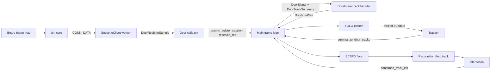

# Thiết kế: Điều phối inference theo thanh ghi cửa 8472-2

Tài liệu yêu cầu: [requirements.md](requirements.md)

## Overview

Thiết kế này hiện thực [requirements.md](requirements.md): AI Core đọc thanh ghi cửa `8472-2`
(slave 2) qua Socket.IO của iot_core và dùng nó để quyết định frame nào chạy YOLO person và SCRFD
face. Khi cửa đóng, cabin hết person track và qua empty grace, cả hai stage ngừng chạy.

Quyết định chính:

- `SocketIoClient` gửi `CONN_SUBSCRIBE` sau namespace ready, lọc `CONN_DATA` đúng SN/level và
  khóa `8472-2`. Callback đưa sample thô vào atomic state; main đọc tại frame boundary.
- `DoorInferenceScheduler` là logic thuần, dùng bit cửa, monotonic time và `DoorTrackSummary` để
  quyết định YOLO/SCRFD. Scheduler không gọi NPU, socket hay DB.
- Sau YOLO, main tính lại summary để SCRFD có thể chạy cùng frame khi track vừa được xác nhận.
- Recognition/interaction dùng lịch retry và confirm hiện có; track đã confirmed không cần SCRFD nữa.
- Context NPU giữ nguyên (load một lần lúc startup); stage bị skip không gọi `awnn_run` hoặc decode.
- Dữ liệu cửa cũ, mất kết nối hoặc reconnect đưa scheduler về `DEGRADED` và quét YOLO thưa, không
  tắt inference.
- Rollback về pipeline baseline bằng `--no-adaptive-inference` (`FACE_ADAPTIVE_INFERENCE=0` trong
  `env.sh`).

Ngoài phạm vi: chính sách gửi lệnh gọi tầng giữ nguyên. Các con số mặc định ở mục Data Models cần đo
và chỉnh trên camera/board thật.

## Architecture



Parse packet và callback chạy trên worker thread của `SocketIoClient`. Callback chỉ ghi ba biến
atomic (`door_register`, `door_session`, `door_received_ms`), không khóa và không chặn main. Main
đọc các biến này ở đầu mỗi frame, sau `tracker->predict`.

### Luồng mỗi frame

```cpp
FrameContext tracker_frame{frame_id, now_ms(), frame.cols, frame.rows};
tracker->predict(tracker_frame);
bool run_person = use_tracker && (frame_id % cfg.person_every == 0); // baseline
bool run_face   = true;                                               // baseline
if (adaptive) {
    const bool fresh = iot_socket && iot_socket->connected() &&
                       door_session == iot_socket->session() && door_received_ms >= 0.0 &&
                       tracker_frame.timestamp_ms - door_received_ms <= 5000.0;
    DoorSignal  signal = decode_door_register(door_register, fresh);
    DoorRunPlan plan   = door_scheduler.plan(now, signal, summarize_door_tracks(...));
    run_person = plan.run_person;
    run_face   = plan.run_face;
}
if (run_person || run_face) detect_preprocess(...); // letterbox 640x640 dùng chung
if (run_person) {
    run_yolo();
    tracker->update(persons, tracker_frame);
}
if (adaptive && !run_face)
    run_face = door_scheduler.face_after_person(now, summarize_door_tracks(...));
faces.clear();
if (run_face) run_scrfd();
// associate_faces_to_tracks, rồi recognition theo needs_recognition của từng track
```

Frame bỏ qua YOLO không gọi `tracker->update`, để track không bị làm già bởi detection rỗng.
`face_after_person` chỉ có thể nâng `run_face` từ false lên true; YOLO không chạy lần hai trong frame.

### Điều kiện bật

`adaptive = cfg.adaptive_inference && use_resident_db && use_tracker && --iot-ws khác rỗng`, trong
đó `use_tracker` nghĩa là có `--person-model`. Thiếu một điều kiện thì main giữ pipeline baseline:
YOLO theo `frame_id % person_every`, SCRFD mỗi frame. Subscription `CONN_SUBSCRIBE` bật khi
`cfg.adaptive_inference && use_tracker`.

### Ưu tiên chọn state

```text
if !signal.fresh or chưa thấy bit 5/6 kể từ lần signal fresh gần nhất:  DEGRADED
else if cửa đang chốt mở (đã thấy bit 5, chưa thấy bit 6):               DOOR_OPEN
else if tracks.active > 0:                                               OCCUPIED
else if < 3000 ms từ lần cuối có track, hoặc từ lúc cửa đóng sau khi mở: EMPTY_GRACE
else:                                                                    IDLE
```

`DOOR_OPEN` ưu tiên hơn `OCCUPIED` để giữ YOLO 15 FPS trong lúc người có thể bước vào. Khi state đổi,
deadline YOLO và SCRFD được kéo về `now`, nên bit 5 làm YOLO chạy ngay ở frame đầu tiên thấy nó.

### Tích hợp occupancy

Khi state của frame là `DEGRADED`, main gọi `occupancy_counter->update(..., tracking_unreliable=true)`
để counter chuyển sang uncertain (xem spec `cabin-occupancy`).

## Components and Interfaces

### `SocketIoClient` (subscription cửa)

```cpp
struct SocketIoConfig {
    std::string device_code   = "2026010900100098"; // dùng cho cả sn và level
    bool        subscribe_door = false;
    std::string door_register = "8472-2";
    // ... các trường floor command hiện có
};

std::string socketio_subscribe_packet(const SocketIoConfig& config);
bool parse_socketio_door_data(const std::string& message, const SocketIoConfig& config,
                              DoorRegisterSample& out);
void SocketIoClient::set_door_callback(DoorCallback callback);
```

- Khi nhận `40` (namespace ready) và `subscribe_door=true`, worker gửi
  `42["CONN_SUBSCRIBE",{"sn":<device_code>,"level":<device_code>}]`. Mỗi lần namespace connect,
  `session()` tăng một.
- `CONN_SUBSCRIBE_RESULT` có `status` khác `"true"` chỉ log warning.
- `parse_socketio_door_data` nhận packet bắt đầu bằng `42["CONN_DATA",`, có `sn` và `level` bằng
  `device_code` và có object `data`. Nếu `data` có khóa `8472-2`, giá trị phải là số nguyên
  0..65535 (dạng số hoặc chuỗi số); sai thì cả packet bị bỏ. Không có khóa thì `has_value=false`
  (gói partial).
- Callback được copy dưới `callback_mutex_`, rồi gọi trên worker thread sau khi nhả mutex.

### Door callback và atomic state (main)

```cpp
std::atomic<std::uint16_t> door_register{0};
std::atomic<double>        door_received_ms{-1.0};
std::atomic<std::uint64_t> door_session{0};
```

Callback làm hai việc:

1. Nếu `sample.has_value`: ghi `door_register` và `door_session = session()`.
2. Nếu `door_session == session()` và session khác 0: ghi `door_received_ms = now_ms()`.

Gói partial vì vậy giữ giá trị cửa cũ nhưng làm mới thời điểm nhận, miễn là session hiện tại đã có ít
nhất một giá trị `8472-2`. Sau reconnect, session mới khác `door_session` cho tới khi có gói chứa
`8472-2`, nên giá trị của session cũ không được coi là mới.

### `decode_door_register`

```cpp
DoorSignal decode_door_register(std::uint16_t value, bool fresh);
```

`opening` lấy bit 5, `closing` lấy bit 6. Hai bit cùng bật là trạng thái mâu thuẫn và trả
`fresh=false`. Các bit khác bị bỏ qua.

### `DoorInferenceScheduler`

```cpp
class DoorInferenceScheduler {
public:
    DoorRunPlan plan(double now_ms, DoorSignal door, DoorTrackSummary tracks);
    // Re-evaluate the face gate after YOLO creates/confirms a track this frame.
    bool face_after_person(double now_ms, DoorTrackSummary tracks);
};
```

State nội bộ:

- `door_known_`: đã thấy bit 5 hoặc bit 6 kể từ lần signal fresh gần nhất; reset khi signal không
  fresh.
- `door_open_latched_`: bật khi thấy bit 5, tắt khi thấy bit 6 hoặc khi signal không fresh. Giá trị
  không có bit 5 và bit 6 giữ nguyên chốt.
- `next_person_ms_`, `next_face_ms_`: deadline theo monotonic time, không theo frame modulo.
- `last_presence_ms_`, `last_close_ms_`: mốc cho empty grace. `last_close_ms_` chỉ được ghi khi bit 6
  đến lúc cửa đang chốt mở.

`plan()`:

1. Cập nhật mốc presence và chốt cửa.
2. Chọn state theo thứ tự ở mục "Ưu tiên chọn state".
3. Nếu state đổi hoặc đây là lần gọi đầu, kéo cả hai deadline về `now`.
4. `run_person = interval(state) > 0 && now >= next_person_ms_`; khi chạy thì
   `next_person_ms_ = now + interval`.
5. `run_face = face_after_person(now, tracks)`.

`face_after_person()`:

- Nếu có track unresolved và state là `OCCUPIED` hoặc `DEGRADED`, kéo `next_person_ms_` về muộn nhất
  là `now + 100`.
- Trả true khi state khác `IDLE`, `unresolved > 0`, `tracked > 0` và `now >= next_face_ms_`; khi đó
  `next_face_ms_ = now + 100` (trần 10 FPS).

### `summarize_door_tracks` (main)

```cpp
static DoorTrackSummary summarize_door_tracks(const std::vector<TrackView>& tracks,
                                              const std::set<int>&          confirmed_track_ids,
                                              bool                          operational);
```

- `active`: số track ở trạng thái `Tracked` hoặc `Lost`.
- `tracked`: track `Tracked && !predicted_only`, tức có detection YOLO thật.
- `unresolved`: track chưa latch identity, hoặc `resident_id < 0`, hoặc (khi có resident DB) chưa có
  trong `confirmed_track_ids`.

`confirmed_track_ids` nhận `subject_key` khi interaction trả outcome confirmed. Id bị xóa khi track
không còn sống hoặc khi catalog reload ảnh hưởng tới subject đó.

Theo quy tắc này, track unknown (`resident_id < 0`) luôn là unresolved, nên SCRFD tiếp tục chạy tối đa
10 FPS chừng nào track đó còn trong cabin.

### Cấu hình và rollback

- `AppConfig::adaptive_inference` mặc định `true`; `--no-adaptive-inference` đặt về `false`.
- `env.sh` mặc định `FACE_ADAPTIVE_INFERENCE=1`; đặt `0` thì `face_cabin` truyền
  `--no-adaptive-inference`.
- Interval, grace và TTL là hằng số trong `src/door_inference.cpp` và `src/main.cpp`, chưa có tham số
  CLI hay cột trong bảng `cabins`. Đổi số cần build lại.

### Log

- Startup: `[scheduler] door-gated inference=enabled|disabled register=8472-2 bits=open:5,close:6`.
- Mỗi lần đổi state: `[scheduler] state=<STATE> door_fresh=<0|1> tracks=<n> unresolved=<n>`.
- Theo window metrics hiện có (khi không có `--preview`):
  `[scheduler] window_frames=<n> yolo_runs=<n> scrfd_runs=<n> recog_runs=<n> state=<STATE>`.

Log `[scheduler]` chỉ chứa tên state, cờ và số đếm.

## Data Models

```cpp
// src/socketio_client.h
struct DoorRegisterSample {
    bool          has_value = false; // false: gói partial, giữ giá trị cũ
    std::uint16_t value     = 0;
};

// src/door_inference.h
enum class DoorInferenceState { Idle, DoorOpen, Occupied, EmptyGrace, Degraded };

struct DoorSignal {
    bool fresh   = false;
    bool opening = false; // bit 5
    bool closing = false; // bit 6
};

struct DoorTrackSummary {
    int active     = 0;
    int tracked    = 0;
    int unresolved = 0;
};

struct DoorRunPlan {
    DoorInferenceState state      = DoorInferenceState::Degraded;
    bool               run_person = false;
    bool               run_face   = false;
};
```

Tên state trong log: `IDLE`, `DOOR_OPEN`, `OCCUPIED`, `EMPTY_GRACE`, `DEGRADED`
(`door_inference_state_name`).

### Thông số mặc định

| State | Nhịp YOLO |
|---|---|
| `IDLE` | không chạy |
| `DOOR_OPEN` | 15 FPS (khoảng 66.7 ms) |
| `OCCUPIED` | 5 FPS (200 ms); 10 FPS (100 ms) nếu có track unresolved |
| `EMPTY_GRACE` | 5 FPS (200 ms) |
| `DEGRADED` | 2 FPS (500 ms); 10 FPS (100 ms) nếu có track unresolved |

- SCRFD, ở mọi state trừ `IDLE`: chạy khi có ít nhất một track unresolved có detection thật
  (`tracked > 0`), tối đa 10 FPS (100 ms).
- Empty grace: 3000 ms tính từ lần cuối có track active, hoặc từ lúc bit 6 đến khi cửa đang chốt mở.
- TTL dữ liệu cửa: 5000 ms giữa `tracker_frame.timestamp_ms` và `door_received_ms`.
- Mọi mốc thời gian lấy từ `now_ms()` (`std::chrono::steady_clock`), cả ở callback và frame loop.

Các con số cần đo và chỉnh trên camera/board thật.

## Correctness Properties

*Property là đặc tính phải đúng trên mọi lần chạy hợp lệ của hệ thống, tức một phát biểu hình thức
về việc hệ thống phải làm gì. Property là cầu nối giữa đặc tả đọc được và kiểm chứng tự động.*

Các Property 1 đến 5 áp dụng cho `decode_door_register` và `DoorInferenceScheduler`, property 8 cho
`parse_socketio_door_data`. Đây là logic thuần nên test được trên host, không cần NPU hay camera.
Các Property 6, 7, 9, 10 nằm trong frame loop và door callback của `src/main.cpp`.

Trong dòng **Validates**, `N` là Requirement N trong requirements.md: 1 bit cửa, 2 YOLO rồi
SCRFD, 3 ngừng khi trống, 4 gói partial và mất dữ liệu, 5 baseline khi thiếu Socket.IO hoặc person
model, 6 rollback. "Đoạn quyết định" là đoạn "Quyết định 2026-10-22" trong mục Introduction của
requirements.md.

### Property 1: Giải mã thanh ghi cửa

*Với mọi* `value` 16 bit và cờ `fresh`, `decode_door_register` trả `opening` bằng bit 5 và `closing`
bằng bit 6. Nếu cả hai bit cùng bật, kết quả có `fresh=false`. Các bit khác không ảnh hưởng kết quả.

**Validates: Requirements 1**

### Property 2: Thứ tự ưu tiên state

*Với mọi* chuỗi `(now_ms, DoorSignal, DoorTrackSummary)`, `plan()` trả state của nhánh đầu tiên khớp ở
mục "Ưu tiên chọn state". Signal không fresh luôn cho `DEGRADED`. Sau khi signal mất fresh, scheduler
giữ `DEGRADED` cho tới khi thấy lại bit 5 hoặc bit 6 trong một signal fresh.

**Validates: Requirements 1, 3, 4**

### Property 3: Đổi state đánh thức YOLO

*Với mọi* lịch sử scheduler và mọi giá trị deadline, lần `plan()` đầu tiên có state khác lần trước
(hoặc lần gọi đầu tiên) trả `run_person=true` nếu state mới khác `IDLE`. Vì vậy frame đầu tiên có bit
5 fresh khi cửa chưa chốt mở trả `DOOR_OPEN` với `run_person=true`.

**Validates: Requirements 1**

### Property 4: Nhịp YOLO theo deadline

*Với mọi* chuỗi `now_ms` tăng dần với khoảng cách frame bất kỳ, trong một đoạn state không đổi, hai lần
`run_person=true` liên tiếp cách nhau ít nhất interval nhỏ nhất của state đó (bảng ở mục Data Models).
`IDLE` không bao giờ trả `run_person=true`. Nhịp không phụ thuộc số frame.

**Validates: Requirements 1, 3**

### Property 5: Cổng SCRFD

*Với mọi* lời gọi `face_after_person`, kể cả lời gọi bên trong `plan()`, kết quả true chỉ khi state
khác `IDLE`, `unresolved > 0` và `tracked > 0`. Trong cùng một state, hai lần true liên tiếp cách nhau
ít nhất 100 ms. Cabin chỉ có track đã confirmed không chạy SCRFD.

**Validates: Requirements 2**

### Property 6: SCRFD cùng frame sau YOLO

*Với mọi* frame adaptive, main gọi `face_after_person` với summary sau YOLO chỉ khi
`plan.run_face=false`. Lời gọi này chỉ có thể đổi `run_face` từ false sang true và không làm YOLO
chạy thêm lần nào trong frame.

**Validates: Requirements 2**

### Property 7: Độ mới dữ liệu cửa

*Với mọi* chuỗi callback (gói đầy đủ, gói partial, reconnect) và mọi frame, signal fresh khi và chỉ
khi socket đang connected, `door_session` bằng `session()` hiện tại, đã có `door_received_ms`, và
`tracker_frame.timestamp_ms - door_received_ms <= 5000`. Gói partial không đổi `door_register`. Sau
reconnect, signal không fresh cho tới khi session mới nhận một gói chứa `8472-2`.

**Validates: Requirements 4**

### Property 8: Lọc packet `CONN_DATA`

*Với mọi* chuỗi message, `parse_socketio_door_data` trả true khi và chỉ khi message bắt đầu bằng
`42["CONN_DATA",`, `sn` và `level` bằng `device_code`, có object `data`, và khóa `8472-2` hoặc vắng
mặt (`has_value=false`) hoặc là số nguyên 0..65535. Message bị từ chối không gọi callback nên không
đổi atomic state.

**Validates: Requirements 4** (và đoạn quyết định: slave id 2)

### Property 9: Stage bị skip không chạy NPU

*Với mọi* frame, `run_person=false` thì không có `awnn_run` trên YOLO, không decode và không
`tracker->update`. `run_face=false` thì không có `awnn_run` trên SCRFD và `faces` rỗng. Cả hai false
thì không gọi `detect_preprocess`. Context NPU không bao giờ bị unload lúc runtime.

**Validates: Requirements 3** (và đoạn quyết định: model load một lần)

### Property 10: Baseline khi adaptive tắt

*Với mọi* cấu hình có `adaptive=false` (cờ `--no-adaptive-inference`, thiếu `--iot-ws`, thiếu person
model hoặc resident DB), lịch stage trùng baseline: YOLO khi `frame_id % person_every == 0`, SCRFD mọi
frame, và scheduler không được gọi.

**Validates: Requirements 5, 6**

### Property 11: Log không chứa PII

*Với mọi* log `[scheduler]`, nội dung chỉ gồm tên state, cờ `door_fresh` và số đếm; không có tên
resident, `greeting_name`, căn hộ, URL camera hay payload.

**Validates:** hard rule về PII trong `AGENTS.md`

## Error Handling

Nguyên tắc: lỗi ở dữ liệu cửa không được tắt inference vô hạn hay chặn main loop. Khi không tin được
dữ liệu cửa, scheduler ở `DEGRADED` và quét YOLO thưa. Parser trả `false` khi lỗi, không throw.

| Tình huống | Xử lý |
|---|---|
| `CONN_DATA` sai `sn` hoặc `level` | Bỏ packet; callback không chạy |
| Có khóa `8472-2` nhưng giá trị không phải số hoặc lớn hơn 65535 | Bỏ cả packet; giá trị và thời điểm nhận giữ nguyên, nên quá 5000 ms không có gói hợp lệ thì chuyển `DEGRADED` |
| Gói partial không có `8472-2` | Giữ giá trị cũ; làm mới `door_received_ms` nếu session hiện tại đã có giá trị |
| Bit 5 và bit 6 cùng bật | `fresh=false`, `DEGRADED` |
| Chưa thấy bit 5/6 kể từ khi dữ liệu fresh (ví dụ giá trị 0 lúc startup) | `DEGRADED` |
| `CONN_SUBSCRIBE_RESULT` có `status` khác `"true"` | Log warning; không có dữ liệu nên signal không fresh, `DEGRADED` |
| Mất kết nối hoặc reconnect | `connected()` false hoặc session đổi, signal không fresh, `DEGRADED` cho tới khi có gói chứa `8472-2` |
| Không có `CONN_DATA` quá 5000 ms | `DEGRADED` |
| `SocketIoClient::start()` thất bại | `iot_socket` bị reset nhưng `adaptive` vẫn true theo cấu hình; signal luôn không fresh nên ở `DEGRADED` cố định (YOLO 2 FPS, 10 FPS khi có track unresolved) |
| Thiếu `--iot-ws`, person model hoặc resident DB | Pipeline baseline |
| Đang `DEGRADED` | Occupancy counter nhận `tracking_unreliable=true` và chuyển uncertain |
| Callback chạy trên worker thread | Chỉ ghi atomic; main đọc ở frame boundary, không chờ socket |

## Testing Strategy

Test chạy bằng `bash tests/run_tests.sh`; mỗi test là một `main()` riêng và đã đăng ký trong script.
Số trong ngoặc là property được test kiểm.

### Unit tests

- `tests/test_door_inference.cpp` (mục "Door inference scheduler"): giá trị 0 trước khi biết trạng
  thái cửa cho `DEGRADED`; cabin trống cửa đóng không chạy stage nào; bit 5 đánh thức YOLO mà chưa
  chạy SCRFD; `face_after_person` cho SCRFD cùng frame; deadline chặn chạy lặp; identity confirmed
  dừng SCRFD; cửa đóng còn người giữ `OCCUPIED`; empty grace rồi `IDLE`; mất dữ liệu cho `DEGRADED`;
  bit mâu thuẫn không fresh; track unresolved tăng nhịp YOLO dự phòng (Property 1 đến 5).
- `tests/test_socketio_client.cpp` (mục "Socket.IO floor command"): packet `CONN_SUBSCRIBE`; parse bit
  mở của slave 2; gói partial giữ giá trị; chuỗi số được nhận; giá trị 70000 bị từ chối; sai thiết bị
  bị từ chối (Property 8).
- `tests/test_app_config.cpp` (mục "AppConfig"): adaptive bật mặc định; `--no-adaptive-inference`
  được parse (phần cấu hình của Property 10).

### Kiểm thử thủ công và trên board

Property 6, 7, 9, 10 (phần frame loop) và 11 nằm trong `src/main.cpp`, chưa có test tự động; kiểm bằng
log `[scheduler]` khi chạy thật.

- Đã làm: đọc thử `CONN_SUBSCRIBE`/`CONN_DATA` thật ở chế độ chỉ đọc, xác nhận `8472-2` có trong
  snapshot và partial update.
- Chưa làm (task cuối trong tasks.md): smoke test board/camera thật, đo độ trễ từ lúc mở cửa tới lần
  YOLO đầu tiên, và xác nhận NPU idle (window log `yolo_runs=0 scrfd_runs=0` ở `IDLE`).
