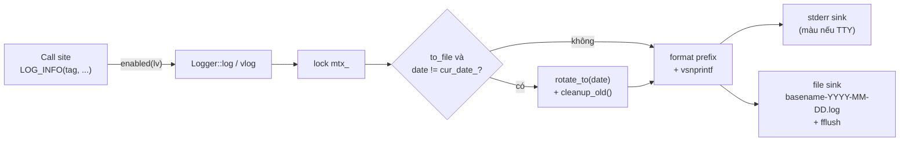

# Design — System / Operational Logging

**Spec ID**: `system-logging`

## Overview

Một logger singleton, thread-safe, tự viết (chỉ C++17 std + POSIX, không dependency mới), dùng chung cho mọi binary trong `src/`. Thành phần chính:
- **Core** (`Logger`): giữ cấu hình (level, dir, sink flags), mutex, file handle của ngày hiện tại.
- **Sinks**: stderr (luôn có) + file theo ngày (tùy chọn).
- **Rotation theo ngày**: khi ghi mà ngày (YYYY-MM-DD) khác ngày của file đang mở → đóng file cũ, mở file mới, dọn file quá hạn.
- **Macro tiện dụng**: `LOG_INFO(tag, fmt, ...)` v.v., kiểm tra level TRƯỚC khi format để bản ghi bị lọc gần như miễn phí.

Cấu hình (level, thư mục) được hợp nhất theo thứ tự CLI > env > mặc định của từng binary. App chính `face_recog_app` ghi stderr + file; các tool offline mặc định chỉ ghi stderr. Các `printf`/`fprintf` dùng để log hiện có được di trú sang logger.

## Architecture

### Bố cục file

Chọn **tách 1 `.cpp`** (`src/log/logger.cpp`) cho phần định nghĩa singleton + state, còn `src/log/logger.h` khai báo API + macro. Lý do: singleton có state (file handle, mutex) không nên định nghĩa trong header (tránh multiple-definition khi nhiều TU include). Đây vẫn "gần header-only" về mặt sử dụng.

> Lưu ý tên file: KHÔNG đặt trùng `src/log/log.h` (shim SDK NPU). Dùng `src/log/logger.h` + `src/log/logger.cpp`.

### Luồng chạy

1. Đầu `main`: `resolve_log_config(argc, argv, defaults)` hợp nhất mặc định của binary + env + CLI → `Logger::instance().init(cfg)`.
2. Mọi thread (capture, display, DB writer...) gọi macro `LOG_*`. Macro kiểm tra level trước, chỉ gọi `Logger::log()` khi bản ghi được bật.
3. `Logger::log()` serialize bằng mutex, xoay file nếu sang ngày mới, rồi ghi ra các sink.



### Thay đổi build (Makefile)

- Thêm `src/log/logger.cpp` vào **tất cả** nhóm nguồn: `COMMON_SRCS` (dùng chung cho mọi binary) là chỗ hợp lý nhất → mọi target tự có logger.
- `-I$(SRC_DIR)` đã có nên `#include "log/logger.h"` resolve được.
- Kiểm tra `<filesystem>`: g++ ≥ 9 không cần `-lstdc++fs`; các tool đã link `-lstdc++fs` sẵn (enroll/capture/add) nên an toàn. Nếu link `main` báo thiếu thì thêm `-lstdc++fs`.

## Components and Interfaces

### `Logger` API (`src/log/logger.h`)

`LogLevel` và `LogConfig` khai báo trong cùng header, xem [Data Models](#data-models).

```cpp
// src/log/logger.h
#pragma once
#include <cstdarg>
#include <string>

// enum class LogLevel, struct LogConfig: xem Data Models.

class Logger {
public:
    static Logger& instance();

    // Khởi tạo 1 lần ở đầu main. Áp CLI/env đã resolve sẵn (xem "Resolve cấu hình").
    // Nếu to_file mà không mở được dir → fallback ./logs + cảnh báo (R5.2).
    void init(const LogConfig& cfg);

    void set_level(LogLevel lv);
    LogLevel level() const;          // dùng để check trước khi format
    bool     enabled(LogLevel lv) const;

    // Ghi 1 bản ghi đã format sẵn (macro gọi hàm này).
    void log(LogLevel lv, const char* tag, const char* fmt, ...);
    void vlog(LogLevel lv, const char* tag, const char* fmt, va_list ap);

    void flush();
    void shutdown();                 // đóng file (gọi cuối main; không bắt buộc)

    // Helpers cấu hình.
    static LogLevel level_from_string(const std::string& s); // "info" → INFO
    static const char* level_name(LogLevel lv);              // INFO → "INFO "
};

// ---- Macro: check level trước để tránh chi phí format khi bị lọc ----
#define LOG_AT(lv, tag, ...)                                        \
    do {                                                           \
        Logger& _lg = Logger::instance();                          \
        if (_lg.enabled(lv)) _lg.log((lv), (tag), __VA_ARGS__);    \
    } while (0)

#define LOG_TRACE(tag, ...) LOG_AT(LogLevel::TRACE, tag, __VA_ARGS__)
#define LOG_DEBUG(tag, ...) LOG_AT(LogLevel::DEBUG, tag, __VA_ARGS__)
#define LOG_INFO(tag, ...)  LOG_AT(LogLevel::INFO,  tag, __VA_ARGS__)
#define LOG_WARN(tag, ...)  LOG_AT(LogLevel::WARN,  tag, __VA_ARGS__)
#define LOG_ERROR(tag, ...) LOG_AT(LogLevel::ERROR, tag, __VA_ARGS__)
```

### Cơ chế bên trong (`src/log/logger.cpp`)

State nội bộ mô tả ở [Data Models](#data-models). Các trường hợp lỗi mô tả ở [Error Handling](#error-handling).

**`log()` / `vlog()`**:
1. (Đã qua check `enabled()` ở macro; kiểm tra lại phòng gọi trực tiếp.)
2. Lấy `now` (`std::chrono::system_clock`), tách ra ngày `YYYY-MM-DD` + giờ `HH:MM:SS.mmm` (dùng `localtime_r`).
3. `lock_guard(mtx_)`.
4. Nếu `to_file` và `date != cur_date_` → `rotate_to(date)`.
5. Format prefix `"<ts> [<LEVEL>] [<tag>] "` rồi `vsnprintf` phần message vào buffer stack (vd 1024B; nếu tràn thì cấp phát động).
6. Ghi ra stderr (kèm màu nếu `cfg_.color && isatty(fileno(stderr))`), ghi ra `fp_` (không màu) nếu bật; `fflush(fp_)` để không mất log khi crash (chấp nhận đánh đổi I/O — log không phải per-frame nóng).

**`rotate_to(date)`**: đóng `fp_` cũ, mở `dir/basename-date.log` chế độ append, cập nhật `cur_date_`, gọi `cleanup_old()`.

**`cleanup_old()`**: quét `dir` các file khớp `basename-YYYY-MM-DD.log`, parse ngày từ tên, xóa file cũ hơn `retention_days` so với hôm nay.

**Màu (tùy chọn)**: TRACE xám, DEBUG xanh dương, INFO mặc định, WARN vàng, ERROR đỏ (ANSI). Chỉ khi stderr là TTY.

### Resolve cấu hình (`resolve_log_config`, thứ tự ưu tiên R5.5)

Hàm free `LogConfig resolve_log_config(argc, argv, defaults)`:
- Bắt đầu từ `defaults` (khác nhau giữa app chính vs tool — xem "Mặc định theo binary" bên dưới).
- Áp env: `FACE_CABIN_LOG_LEVEL`, `FACE_CABIN_LOG_DIR` nếu có.
- Áp CLI: `--log-level`, `--log-dir` (ghi đè env).
- Trả về config đã hợp nhất → `Logger::instance().init(cfg)`.

Các tool đã có vòng lặp parse args riêng; thêm nhận diện `--log-level`/`--log-dir` vào đó (hoặc tách 1 helper chung dùng lại).

### Mặc định theo binary (R8)

| Binary | to_file | dir mặc định | Ghi chú |
|---|---|---|---|
| `face_recog_app` (main) | true | `/var/log/face-cabin` | dịch vụ 24/7; fallback `./logs` |
| `enroll_faces` | false | (n/a) | chỉ stderr; bật file nếu truyền `--log-dir` |
| `add_person` | false | (n/a) | như trên |
| `capture_person` | false | (n/a) | như trên |
| `migrate_fdb` | false | (n/a) | như trên |

Quy tắc: truyền `--log-dir` cho tool → tự động bật `to_file`.

**Chưa quyết:** `FACE_CABIN_LOG_DIR` (env) có tự bật `to_file` cho tool như `--log-dir` hay không.

### Di trú printf → logger (R8.3)

- Thay `printf("[cam] ...")` → `LOG_INFO("cam", ...)`, `fprintf(stderr, "[xxx] ...")` cảnh báo → `LOG_WARN`/`LOG_ERROR` với tag tương ứng.
- Các dòng per-frame nóng trong `main.cpp` (bench `[frame N] fps=...`, `[recog] frame ...`) → hạ xuống `LOG_DEBUG` để không spam file ở INFO. HUD overlay trên ảnh giữ nguyên (không phải log).
- Giữ nguyên `fprintf(stderr, ...)` trong hàm `print_usage()` (in help CLI — không phải log ứng dụng, R8.3 cho phép).
- KHÔNG đụng `src/log/log.h` (shim SDK).
- Khi tham chiếu cư dân trong log, chỉ dùng `resident_id`/`track_id`, không ghi tên thật / `greeting_name` / `apartment` (R7).

## Data Models

### `LogLevel`

```cpp
enum class LogLevel { TRACE=0, DEBUG=1, INFO=2, WARN=3, ERROR=4, OFF=5 };
```

Giá trị số là thứ tự so sánh với ngưỡng (R1.1). `OFF` không có macro tương ứng; dùng làm ngưỡng để tắt toàn bộ log.

### `LogConfig`

```cpp
struct LogConfig {
    LogLevel    level        = LogLevel::INFO;
    bool        to_stderr    = true;
    bool        to_file      = false;         // app chính bật; tool để false
    std::string dir          = "/var/log/face-cabin";
    std::string basename     = "face-cabin";  // → face-cabin-YYYY-MM-DD.log
    int         retention_days = 14;
    bool        color        = true;          // chỉ áp dụng khi stderr là TTY
};
```

### State nội bộ của `Logger`

| Trường | Kiểu | Ý nghĩa |
|---|---|---|
| `cfg_` | `LogConfig` | cấu hình hiện hành (có thể bị sửa khi fallback dir hoặc tắt `to_file`) |
| `mtx_` | `std::mutex` | serialize rotation + ghi |
| `fp_` | `FILE*` | file của ngày hiện tại |
| `cur_date_` | `std::string` | `YYYY-MM-DD` của `fp_` |

### Định dạng dòng log

```
<YYYY-MM-DD HH:MM:SS.mmm> [<LEVEL>] [<tag>] <message>
```

- Timestamp theo giờ địa phương (`localtime_r`), đến millisecond (R2.2).
- `<LEVEL>` là `level_name(lv)`, độn đủ 5 ký tự: `TRACE`, `DEBUG`, `INFO `, `WARN `, `ERROR`.
- Ví dụ (R2.1): `2026-09-03 14:22:01.123 [INFO ] [cam] opened /dev/video0 640x480`.
- Dòng ghi vào file không có mã màu ANSI.

### Tên file log

`<dir>/<basename>-YYYY-MM-DD.log`, mở chế độ append. Mặc định: `/var/log/face-cabin/face-cabin-YYYY-MM-DD.log` (R4.1).

### Nguồn cấu hình

| Khóa | Env | CLI | Mặc định |
|---|---|---|---|
| level | `FACE_CABIN_LOG_LEVEL` | `--log-level <level>` (`trace`, `debug`, `info`, `warn`, `error`) | `INFO` |
| dir | `FACE_CABIN_LOG_DIR` | `--log-dir <dir>` | `/var/log/face-cabin` (main); tool: không ghi file |

## Correctness Properties

Các tính chất dưới đây phải đúng với mọi lần chạy. Mỗi tính chất ghi rõ yêu cầu nó kiểm chứng.

### Property 1: Lọc theo level

*Với mọi* ngưỡng `T` và mọi bản ghi có level `L` trong `TRACE..ERROR`, bản ghi được ghi ra sink khi và chỉ khi `L >= T`. Với `T = OFF`, không bản ghi nào được ghi.

**Validates: Requirements 1.1, 1.2**

### Property 2: Định dạng dòng

*Với mọi* bản ghi được ghi ra file, dòng tương ứng khớp `^\d{4}-\d\d-\d\d \d\d:\d\d:\d\d\.\d{3} \[(TRACE|DEBUG|INFO |WARN |ERROR)\] \[<tag>\] <message>$`, với timestamp là giờ địa phương tại thời điểm gọi.

**Validates: Requirements 2.1, 2.2**

### Property 3: Sink nhận đúng bản ghi

*Với mọi* bản ghi được bật, bản ghi xuất hiện trên stderr; và xuất hiện trong file khi và chỉ khi `to_file = true`.

**Validates: Requirements 3.1, 3.2, 3.3**

### Property 4: Màu chỉ trên TTY

*Với mọi* bản ghi, file log không chứa mã ANSI; stderr chỉ chứa mã ANSI khi `color = true` và stderr là TTY.

**Validates: Requirements 3.4**

### Property 5: Tách file theo ngày

*Với mọi* bản ghi ghi ra file, bản ghi nằm trong `<dir>/<basename>-<D>.log` với `D` là ngày địa phương trong timestamp của chính bản ghi đó. Bản ghi đầu tiên mang ngày mới làm mở file mới.

**Validates: Requirements 4.1, 4.2**

### Property 6: Retention

*Với mọi* tập file trong `dir`, sau `cleanup_old()`: không còn file khớp `<basename>-YYYY-MM-DD.log` có ngày cũ hơn hôm nay − `retention_days`; file khớp mẫu còn trong hạn vẫn giữ nguyên; file không khớp mẫu không bị đụng.

**Validates: Requirements 4.3**

### Property 7: Không crash khi thư mục không dùng được

*Với mọi* `dir` không tạo hoặc không ghi được, `init()` trả về bình thường; logger kết thúc ở trạng thái ghi `./logs` hoặc chỉ ghi stderr, và có cảnh báo fallback in ra stderr.

**Validates: Requirements 5.2**

### Property 8: Thứ tự ưu tiên cấu hình

*Với mỗi* khóa (`level`, `dir`), giá trị sau `resolve_log_config` bằng giá trị CLI nếu có, ngược lại bằng env nếu có, ngược lại bằng mặc định của binary. Không có CLI/env thì `level = INFO`.

**Validates: Requirements 1.3, 5.3, 5.4, 5.5**

### Property 9: Dòng nguyên vẹn khi đa luồng

*Với mọi* N thread, mỗi thread ghi M bản ghi, file chứa đúng N×M dòng và mỗi dòng là một bản ghi nguyên vẹn (thỏa Property 2).

**Validates: Requirements 6.1**

### Property 10: Bản ghi bị lọc không tốn chi phí format

*Với mọi* lời gọi `LOG_*` có level dưới ngưỡng, `Logger::log()` không được gọi và các đối số format không được evaluate.

**Validates: Requirements 0** "Hiệu Năng"

### Property 11: `--log-dir` bật file cho tool

*Với mọi* tool offline, không truyền `--log-dir` thì `to_file = false`; truyền `--log-dir <d>` thì `to_file = true` và file được ghi vào `<d>`.

**Validates: Requirements 8.2**

## Error Handling

### Fallback thư mục khi `init()` (R5.2)

Trong `init()` khi `to_file`:
1. `std::filesystem::create_directories(cfg_.dir)` trong try/catch.
2. Thử mở file ngày hiện tại. Nếu OK → dùng.
3. Nếu lỗi (permission) → đặt `cfg_.dir = "./logs"`, tạo lại, in cảnh báo ra stderr: `"[log] cannot use <dir>, falling back to ./logs"`. Nếu vẫn lỗi → tắt `to_file` (chỉ stderr), cảnh báo 1 lần.

### Lỗi khi đang chạy

- **`rotate_to(date)` mở file mới lỗi**: tắt `to_file`, log 1 cảnh báo ra stderr (không lặp).
- **Lỗi filesystem trong `cleanup_old()`**: bọc try/catch quanh `<filesystem>` để lỗi FS không làm chết app.
- **`log()`/`vlog()` gọi trực tiếp, không qua macro**: kiểm tra lại `enabled()` trước khi xử lý.
- **Message dài hơn buffer stack (vd 1024B)**: cấp phát động thay vì dùng buffer stack.

**Chưa quyết:** hành vi của `level_from_string` khi `--log-level` hoặc `FACE_CABIN_LOG_LEVEL` có giá trị không hợp lệ.

## Testing Strategy

### Unit (máy dev / WSL, không NPU) — `tests/test_logger.cpp`

- **Level filtering** (Property 1): set WARN → DEBUG/INFO không ghi, WARN/ERROR có ghi (ghi ra file tạm rồi đọc lại đếm dòng).
- **Định dạng** (Property 2): dòng khớp regex `^\d{4}-\d\d-\d\d \d\d:\d\d:\d\d\.\d{3} \[(TRACE|DEBUG|INFO |WARN |ERROR)\] \[tag\] msg`.
- **Rotation theo ngày** (Property 5): giả lập bằng cách cho phép inject "ngày" (thêm hook test) HOẶC kiểm tra tên file chứa ngày hôm nay + tạo file ngày cũ rồi gọi cleanup → bị xóa.
- **Fallback dir** (Property 7): init với dir không ghi được (vd đường dẫn cấm) → không crash, chuyển `./logs`.
- **Thread-safe** (Property 9): nhiều thread cùng log → không có dòng bị xen (mỗi dòng nguyên vẹn, đúng số dòng).
- **Retention** (Property 6): tạo file cũ giả (đổi tên có ngày quá hạn) → cleanup xóa đúng, giữ file trong hạn.

### Tích hợp

- Chạy `face_recog_app` vài giây → có file `/var/log/face-cabin/face-cabin-<hôm nay>.log` (hoặc `./logs/` khi thiếu quyền) (Property 3, 5, 7).
- `--log-level debug` thấy log per-frame; `--log-level warn` im per-frame (Property 1, 8).

### Độ phủ

Property chưa có test riêng trong kế hoạch: Property 4 (màu), Property 8 (đầy đủ thứ tự CLI > env > mặc định), Property 10 (đối số không bị evaluate), Property 11 (`--log-dir` cho tool).

## Risks

| Rủi ro | Giảm thiểu |
|---|---|
| `fflush` mỗi bản ghi làm chậm khi log dày | Log dày (per-frame) để ở DEBUG/TRACE, mặc định INFO nên I/O thấp; cân nhắc bỏ flush ở TRACE nếu cần. |
| `<filesystem>` link lỗi trên toolchain cũ | Thử build; thêm `-lstdc++fs` nếu cần (đã dùng ở tool khác). |
| Thiếu quyền `/var/log` | Fallback `./logs` + cảnh báo (R5.2). |
| Đổi ngày lúc nửa đêm khi đang tải cao | Rotation nằm trong cùng mutex với ghi; chi phí 1 lần/ngày, không đáng kể. |
| Lỡ ghi PII vào log | Review khi di trú; quy ước chỉ dùng `resident_id`/`track_id` (R7). |
